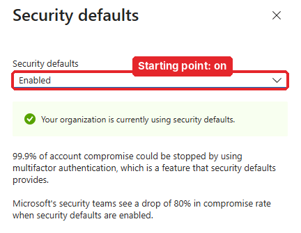
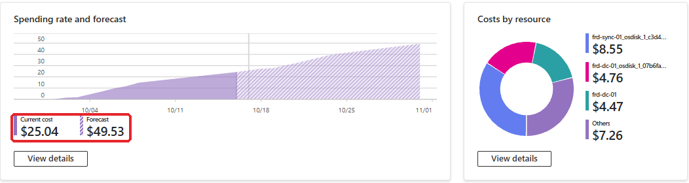
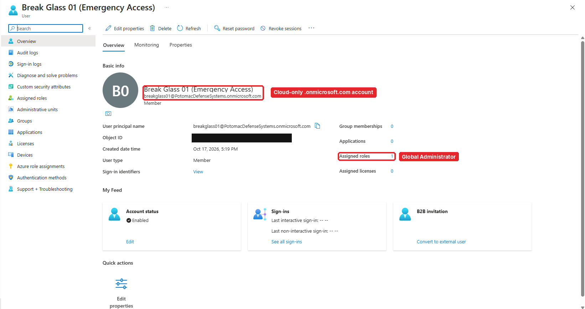
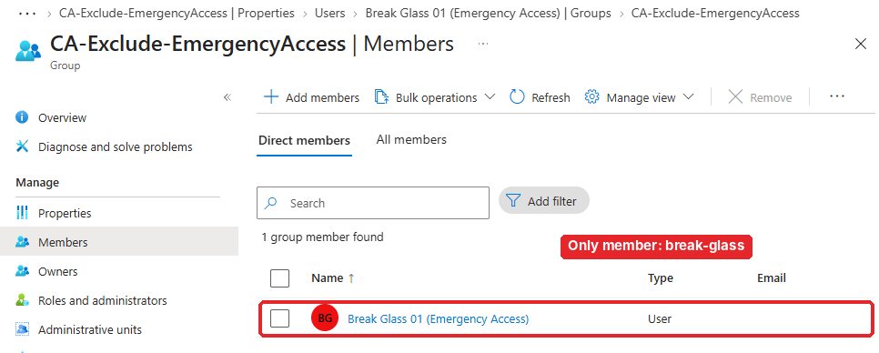
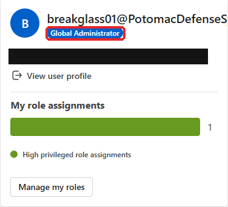
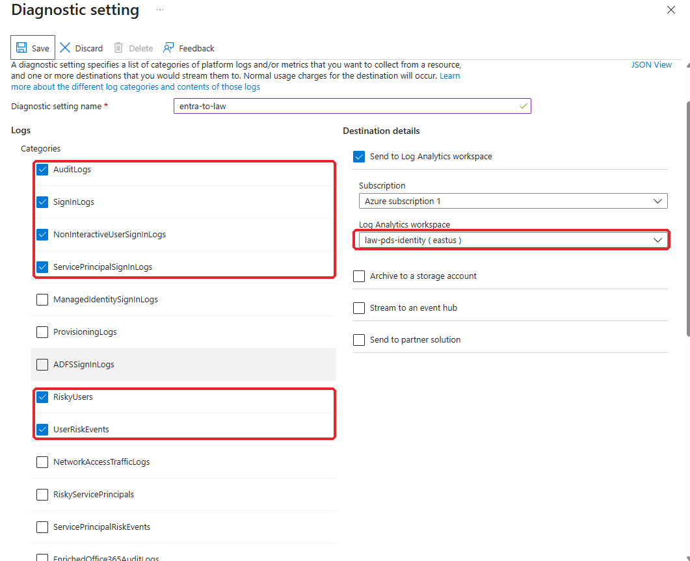
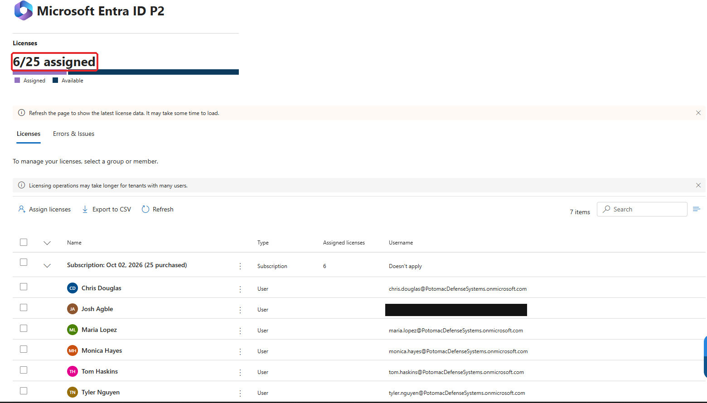

# Part 2.1: Design and Prep

**2.1** · [2.2 Conditional Access →](../2.2-conditional-access/README.md)

> **In this part:** before I built a single policy, I wrote the [design](../../docs/01-design.md), checked the costs, created an emergency access (break-glass) account that Conditional Access can never lock out, and sent Entra's sign-in and audit logs to Log Analytics so every later part can be tested with real data.
>
> **Tenant:** Potomac Defense Systems · Entra ID P2 (trial) · 340 users synced from AD in [Project 1](https://github.com/jagble/hybrid-iam-jml-lab)

---

## Step 1: Write the design first

Conditional Access can lock every admin out of a tenant with one bad policy, so I planned the whole project before touching the portal: seven policies, PIM settings, access packages, reviews and monitoring. The full plan is in [`docs/01-design.md`](../../docs/01-design.md). Its first two rules shaped everything in this part:

1. **Never lock out every admin.** A break-glass account exists before the first policy, and every policy excludes it
2. **Report-only first.** Every policy is tested in report-only mode before it's turned on

Anything that changed during the build is recorded in these walkthroughs, not quietly edited into the design.

## Step 2: Check the starting point

The tenant started with **security defaults** on. Security defaults are Microsoft's free, one-size-fits-all protection: MFA for everyone, legacy authentication blocked. They're a good baseline, but you can't customize them, and they can't run alongside Conditional Access.

**My plan:** leave security defaults on until all seven policies were built and tested, then turn them off and the policies on **in the same sitting**, so the tenant is never left with neither.

## Step 3: Check the costs

Before adding anything, I checked where the subscription stood: about **$25 spent**, with a forecast of about **$50 by November 1**, against a **$75 budget**. The Project 1 VMs (`FRD-DC-01` and `FRD-SYNC-01`) caused most of that, so they stay **stopped** during this project unless a test needs them.

The Entra ID P2 trial covers 25 users and ends November 1. It's set to renew as a paid subscription, so I set a reminder to turn that off before the trial ends.

## Step 4: Create the break-glass account

| Setting | Value | Why |
|---|---|---|
| Account | `breakglass01@PotomacDefenseSystems.onmicrosoft.com` | **Cloud-only** and on the `.onmicrosoft.com` domain, so it still works if sync or a custom domain breaks |
| Role | Global Administrator, **permanent** | The one standing admin in the tenant. If PIM or an approval ever breaks, this still works |
| Password | 25+ character passphrase in a password manager | Never used day to day |
| MFA | Registered | Microsoft now requires MFA for every admin portal sign-in. In production this would be a FIDO2 security key kept in a safe |

## Step 5: Create the exclusion group

Instead of excluding the break-glass account by name in each policy, every policy excludes one group: **`CA-Exclude-EmergencyAccess`**. Adding a second emergency account later means changing one group, not seven policies.

I made this group **role-assignable**. That setting can only be chosen when the group is created, and it means only Global Administrators and Privileged Role Administrators can change its members.

**Why that matters:** anyone added to this group skips every Conditional Access policy in the tenant. Without role-assignable, a much lower-level admin (like a Groups Administrator) could add themselves and walk around MFA. A guest list is only as good as who's allowed to write on it.

## Step 6: Prove the break-glass account works

An emergency account nobody has tested isn't an emergency account. I signed in with it in a private window, confirmed it had Global Administrator, and signed out. That sign-in becomes useful again in Part 2.2, as test data for the break-glass alert.

## Step 7: Send Entra logs to Log Analytics

Entra only keeps sign-in logs for 30 days, and you can't alert on them in the portal. I created a Log Analytics workspace, **`law-pds-identity`** (East US, with a **0.1 GB daily cap** to keep costs predictable), and a diagnostic setting, **`entra-to-law`**, that streams:

| Category | Used for |
|---|---|
| `AuditLogs` | Policy changes, group membership changes, role activations |
| `SignInLogs` | Interactive sign-ins, Conditional Access results, the break-glass alert |
| `NonInteractiveUserSignInLogs` | Token refreshes, which are where a stolen session shows up |
| `ServicePrincipalSignInLogs` | App and script sign-ins (Part 2.8, non-human identities) |
| `RiskyUsers`, `UserRiskEvents` | Identity Protection data for the risk-based policies and incident response |

`ManagedIdentitySignInLogs` and `ProvisioningLogs` aren't on yet. They'll matter in Part 2.8 and Project 3, and I'll turn them on then.

## Step 8: License the test users

P2 features like risk-based policies, PIM and access reviews only apply to licensed users, so I assigned 6 of the 25 trial licenses: my admin account and five test users who each have a job in later parts.

| User | Role in the tests |
|---|---|
| **Chris Douglas** | Engineer with no program access. The main test user: Conditional Access, then requesting program access in 2.4 |
| **Tom Haskins** | Radar program manager. Approves Radar access requests |
| **Monica Hayes** | Security. Approves Global Admin activations in PIM and runs access reviews |
| **Maria Lopez**, **Tyler Nguyen** | Extra users for reviews and incident response |

## What I had at the end of 2.1

- [x] A written design, with a rollback plan
- [x] Costs checked and the trial end date on my calendar
- [x] A tested break-glass account, excluded through a role-assignable group
- [x] Sign-in and audit logs flowing into Log Analytics
- [x] Licensed test users, each with a purpose

---

**Next:** [2.2 Conditional Access →](../2.2-conditional-access/README.md)
