# Part 2.2: Conditional Access

[← 2.1 Design and Prep](../2.1-design-and-prep/README.md) · **2.2** · 2.3 Privileged Identity Management (next)

> **In this part:** I built seven Conditional Access policies, ran every one in **report-only** mode first, proved what each would do with the **What If** tool and real sign-ins, then replaced security defaults and turned them all on. I finished with three alert rules in Log Analytics, and tested the break-glass alert end to end.
>
> **Policies:** [`policies/`](../../policies/) · **Design:** [`docs/01-design.md`](../../docs/01-design.md#3-conditional-access-policies)

This part has a lot of moving pieces, so here's the map:

| # | Section | The lesson |
|---|---|---|
| 1 | [The rules every policy follows](#1-the-rules-every-policy-follows) | Two exclusions on every all-user policy |
| 2 | [CA001: MFA for everyone](#2-ca001-mfa-for-everyone) | What If proves a policy before it touches anyone |
| 3 | [CA002: Block legacy authentication](#3-ca002-block-legacy-authentication) | Old protocols can't do MFA, so they're a bypass |
| 4 | [CA003: Phishing-resistant MFA for admins](#4-ca003-phishing-resistant-mfa-for-admins) | Not all MFA is equal |
| 5 | [CA004: The leaver block](#5-ca004-the-leaver-block) | The fix for Project 1's 79-second gap |
| 6 | [CA005 and CA006: Risk-based policies](#6-ca005-and-ca006-risk-based-policies) | A missing exclusion, and a missing writeback |
| 7 | [CA007: Block outside the US](#7-ca007-block-outside-the-us) | The details page didn't show the exclusion. What If did |
| 8 | [Report-only on a real sign-in](#8-report-only-on-a-real-sign-in) | Check impact before enforcing |
| 9 | [Turning it on](#9-turning-it-on) | Never leave the tenant with neither |
| 10 | [Alerts](#10-alerts) | The break-glass alert, tested end to end |
| 11 | [Findings](#11-findings) | What I'd fix in production |

---

## 1. The rules every policy follows

| Rule | Why |
|---|---|
| **Report-only first** | A report-only policy is evaluated on every sign-in and logged, but never enforced. I can see exactly who it would have affected before it affects anyone |
| **Exclude `CA-Exclude-EmergencyAccess`** on every policy | The break-glass group from [2.1](../2.1-design-and-prep/README.md). One bad policy can't lock out every admin |
| **Exclude the Directory Synchronization Accounts role** on every all-user policy | Entra Connect signs in to the cloud as an account in this role. It can't do MFA, so an MFA or block policy that catches it would quietly break sync for 340 users |
| **Named `CA0xx-Who-What-Control`** | You can tell what a policy does from the list without opening it |

## 2. CA001: MFA for everyone

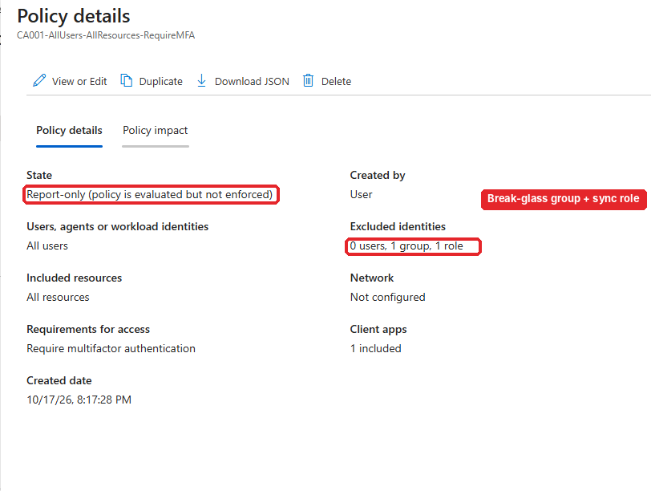

**`CA001-AllUsers-AllResources-RequireMFA`** requires MFA for all users on all resources. It replaces the MFA part of security defaults.

When I created it, Entra warned me to exclude my own admin account so I couldn't lock myself out. I chose **"I understand… Proceed anyway"** on purpose: the break-glass group already covers that, and excluding my daily admin account would leave the most targeted account in the tenant without MFA.

**Testing it with What If.** The What If tool simulates a sign-in and shows which policies would apply, without anyone actually signing in. I used the same settings for every test: **Office 365 Exchange Online**, **Windows**, **Browser**.

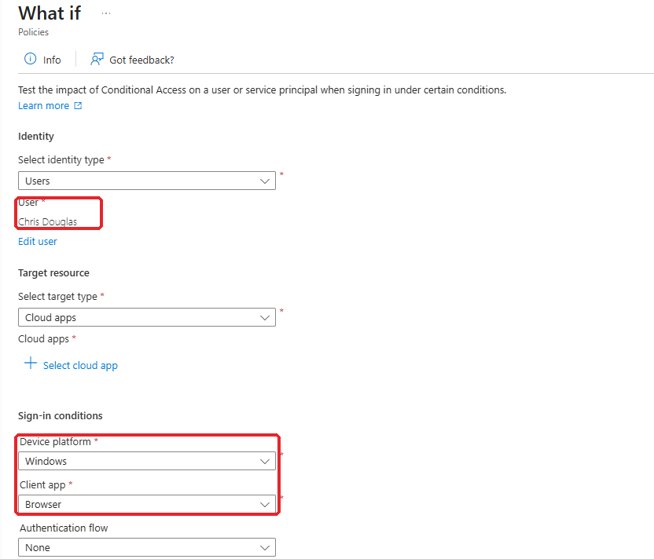

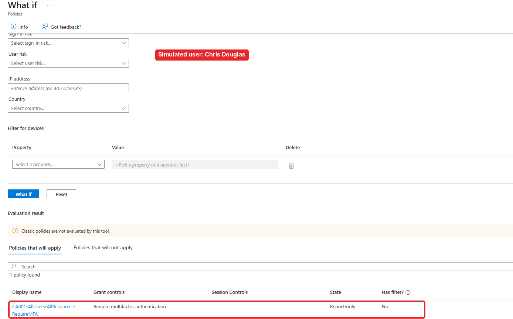

**Chris Douglas:** CA001 applies, require MFA. ✅

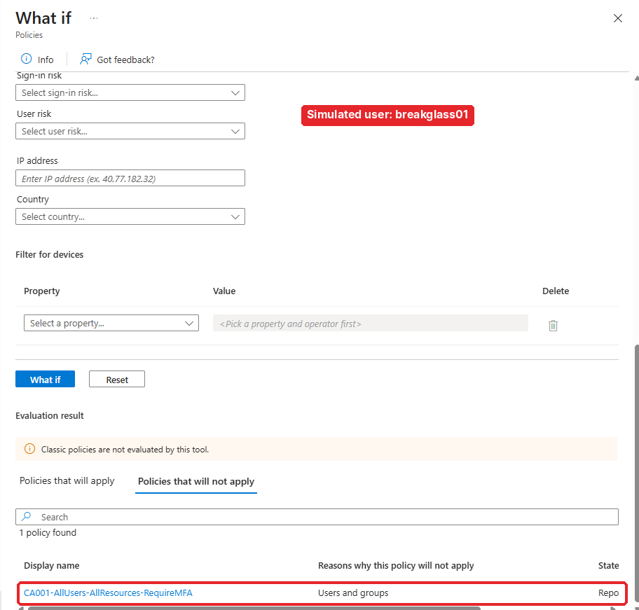

**Break-glass:** nothing applies. CA001 is under "will not apply," reason **Users and groups**. ✅ The exclusion works.

## 3. CA002: Block legacy authentication

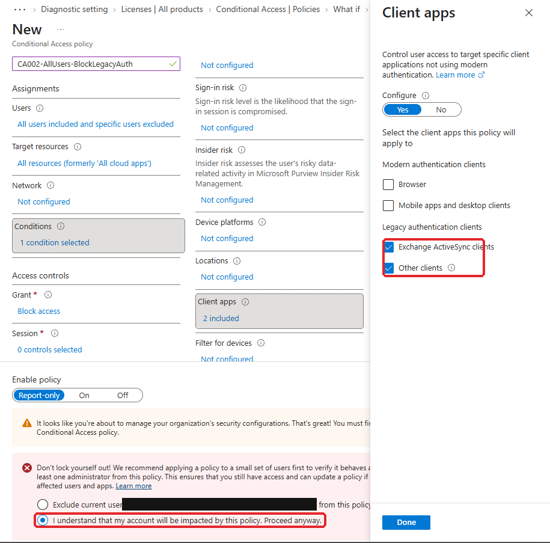

**`CA002-AllUsers-BlockLegacyAuth`** blocks the two legacy client types: **Exchange ActiveSync** and **Other clients** (old POP, IMAP, SMTP and similar).

These protocols only understand a username and password. They have no way to ask for MFA, so leaving them open means an attacker with a stolen password can skip CA001 entirely. Blocking them closes the bypass.

## 4. CA003: Phishing-resistant MFA for admins

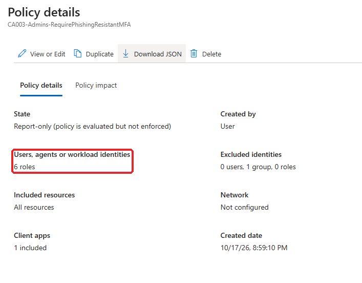

**`CA003-Admins-RequirePhishingResistantMFA`** targets six admin roles (Global, Privileged Role, User, Helpdesk, Security, and Conditional Access Administrator) and requires the **phishing-resistant MFA** authentication strength.

**Why admins need more than regular MFA:** a push notification only proves that someone tapped "Approve." A fake login page can pass the victim's password to Microsoft in real time, and the victim approves the prompt it triggers. A **passkey** can't be tricked that way: it's a private key locked on the device, and it only signs for the real Microsoft sign-in address, so on a look-alike site it simply doesn't work.

The exported [policy JSON](../../policies/CA003-Admins-RequirePhishingResistantMFA.json) shows exactly what this strength accepts: `fido2` (which includes passkeys), `windowsHelloForBusiness` and `x509CertificateMultiFactor` (certificates, which is where Project 3's smart-card-style sign-in fits). Nothing with a password or a push notification qualifies.

Rolling this out to every user at once is hard (devices, recovery, training), so the standard approach is admins first, which is what this policy does.

## 5. CA004: The leaver block

**The problem from Project 1:** when the leaver disabled someone in AD, Entra didn't know until the next sync. Their old password still worked in the cloud **79 seconds** after offboarding.

**The fix:** a cloud-only group the leaver can change instantly, with no sync involved, and a policy that blocks everyone in it from everything.

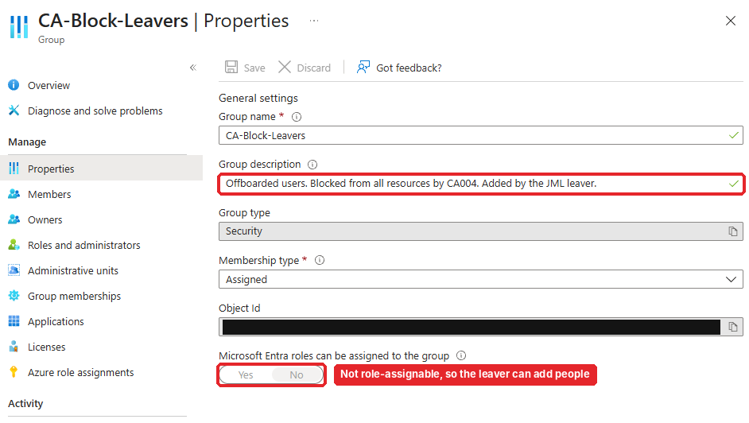

**`CA-Block-Leavers`** is a cloud security group, and this time I deliberately did **not** make it role-assignable. The Project 1 leaver adds people to it through Microsoft Graph, and writing to a role-assignable group needs far broader permissions than `GroupMember.ReadWrite.All`. The trade-off is that more admins can change its membership, so I compensated with an alert on every membership change ([section 10](#10-alerts)).

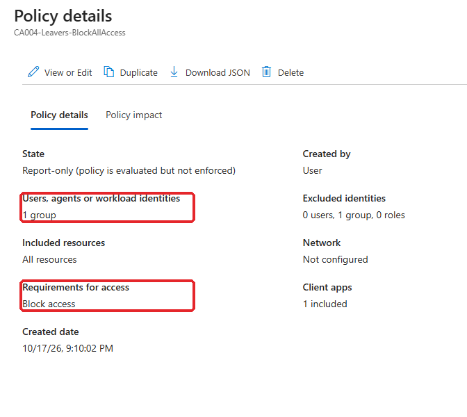

**`CA004-Leavers-BlockAllAccess`**: members of `CA-Block-Leavers`, all resources, **Block access**. In Conditional Access, block always wins over any other policy.

**Still to do:** the real test needs the Project 1 VMs running and the leaver updated to add users to this group. I'll run it later in this project and compare the result against the original 79 seconds.

## 6. CA005 and CA006: Risk-based policies

These use **Identity Protection**, which scores every sign-in and user for signs of compromise.

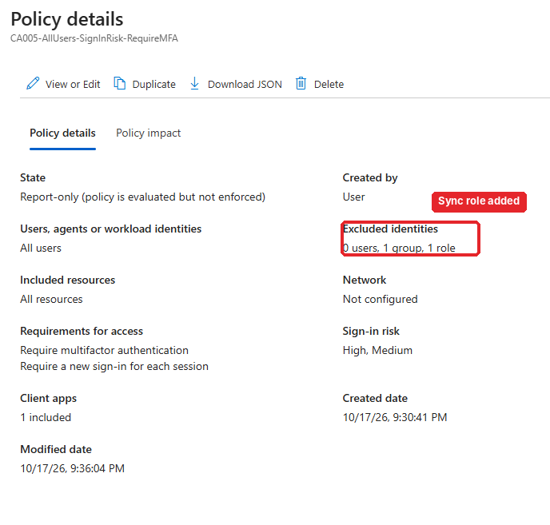

**`CA005-AllUsers-SignInRisk-RequireMFA`**: if a **sign-in** looks risky (anonymous IP, impossible travel, an unfamiliar location), require MFA. Medium and high risk, with sign-in frequency set to **every time**, so a risky session can't reuse an earlier sign-in.

**Caught before it went live:** my first version only excluded the break-glass group. The **Directory Synchronization Accounts** role was missing (the details page said "0 roles" while every other all-user policy said "1 role"). I added it before turning anything on.

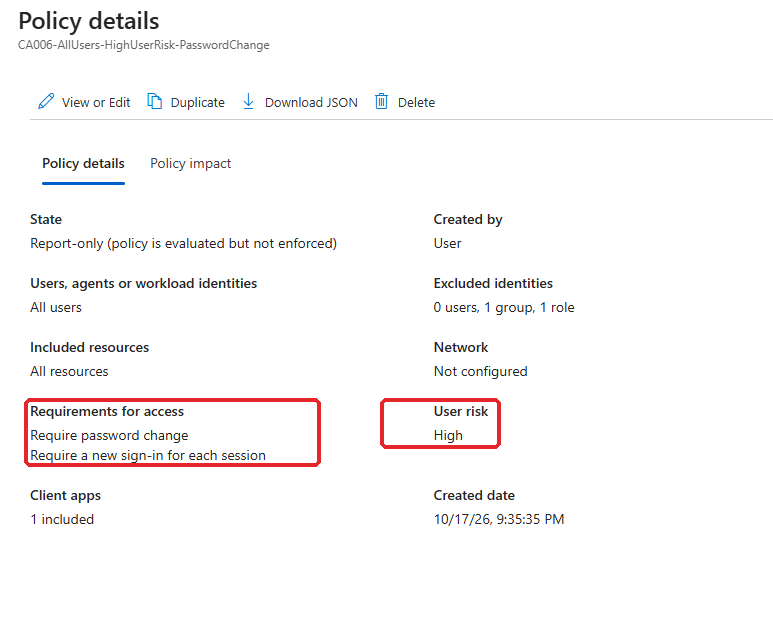

**`CA006-AllUsers-HighUserRisk-PasswordChange`**: if Identity Protection believes the **account itself** is compromised (for example, its password showed up in a leak), require a password change, after MFA.

Two things I learned building this one:

- **"Require MFA" vs. "require authentication strength."** The portal only lets you pick one. "Require MFA" accepts any MFA method. An authentication strength accepts methods from a specific list. I used the built-in **Multifactor authentication** strength here, which accepts the same methods, while CA001 and CA005 use the older control. They behave the same today, but in production I'd standardize on authentication strengths, so tightening MFA later (say, dropping SMS) is one list change instead of an edit to every policy
- **Synced users can't change their password in the cloud** without **password writeback**, which this lab doesn't have. So for a synced user, CA006 doesn't lead to a self-service reset. It blocks them until an admin resets the password in AD. That still fails closed, so it's secure, but every high-risk user becomes a helpdesk ticket. See [Findings](#11-findings)

## 7. CA007: Block outside the US

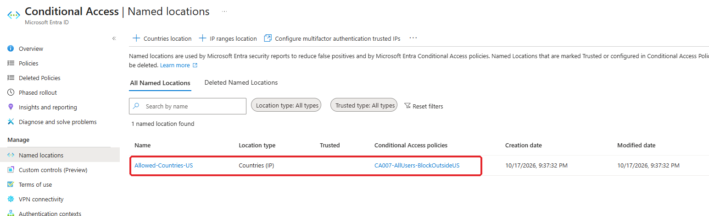

First, a countries named location, **`Allowed-Countries-US`**, with just the United States.

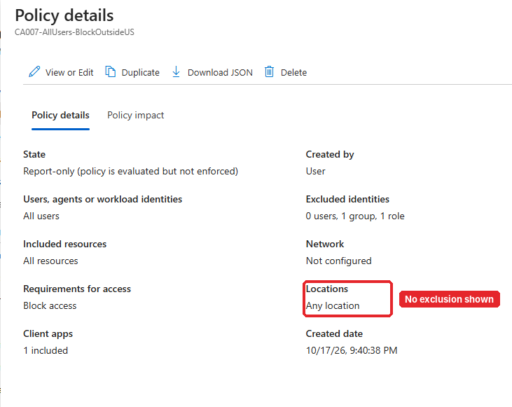

**`CA007-AllUsers-BlockOutsideUS`**: include **any location**, exclude `Allowed-Countries-US`, **Block access**. This is common in federal and defense environments.

**The details page wasn't enough.** It only says "Locations: Any location," with no sign of the US exclusion. If the exclusion hadn't saved, this policy would block everyone everywhere. So I proved it with What If, using real public IP addresses for each country:

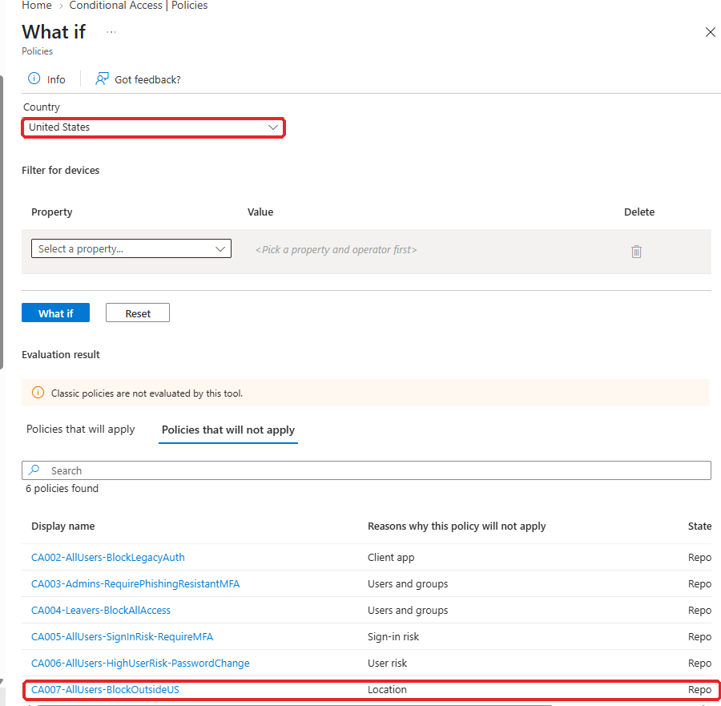

**US IP (`8.8.8.8`):** CA007 is under "will not apply," reason **Location**. Every other reason on that tab also matched the test user: not an admin, not a leaver, no risk, not a legacy client.

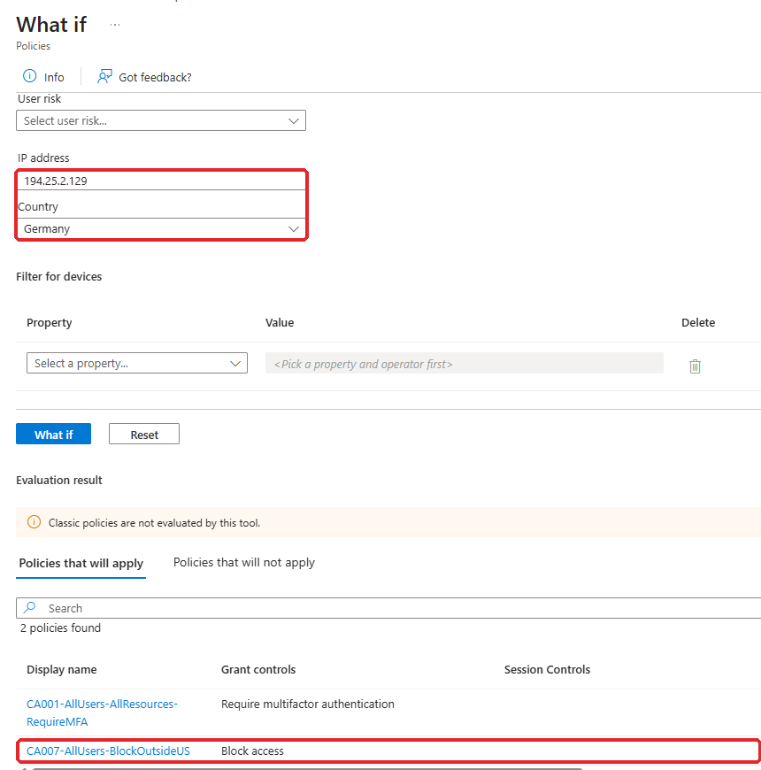

**German IP (`194.25.2.129`):** CA001 and **CA007 (Block access)** apply. ✅

## 8. Report-only on a real sign-in

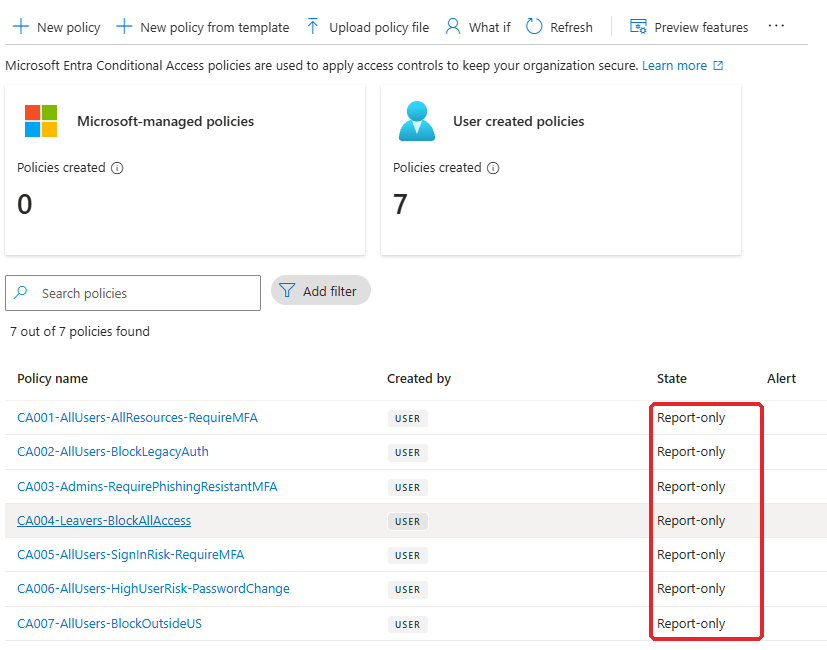

With all seven built in report-only, I checked them against a **real** sign-in: my own admin account, in a private window. The sign-in log's **Report-only** tab shows what each policy would have done.

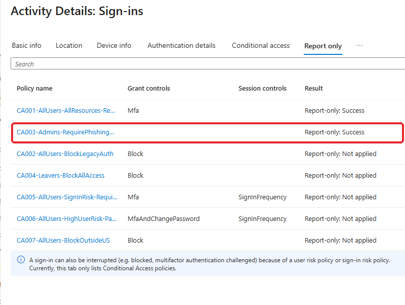

| Policy | Result | Why |
|---|---|---|
| CA001 | Success | I did MFA |
| CA003 | **Success** | See below |
| CA002, CA004–CA007 | Not applied | Browser sign-in, not a leaver, no risk, in the US |

I expected CA003 to show **Failure**, since I hadn't set up phishing-resistant MFA for my admin account yet, which would have meant turning it on would lock me out. Instead, during that sign-in, Microsoft offered to set up a **passkey** in the Authenticator app, and I accepted.

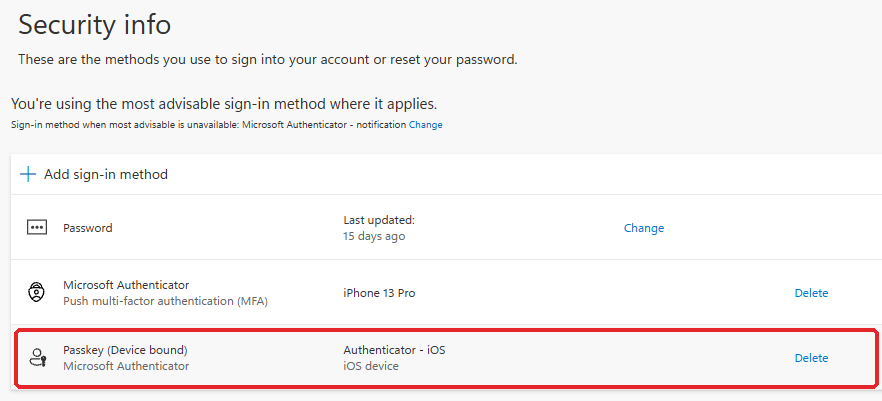

**What I took from it:** this is exactly what report-only is for. If CA003 had shown Failure, I'd have known to fix it before enforcing. It showed Success, so I knew enforcing it was safe.

## 9. Turning it on

Order mattered here:

1. Kept my working session open, with the break-glass credentials ready
2. **Disabled security defaults**, since Entra won't enforce Conditional Access while they're on

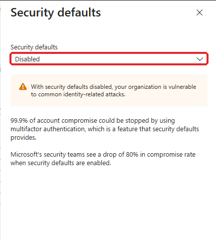

3. Turned on **CA001 and CA002 immediately**, so the tenant was never without MFA
4. Turned on **CA003**, then signed in as myself in a private window with the passkey to confirm I could still get in
5. Turned on **CA004 to CA007**, one at a time

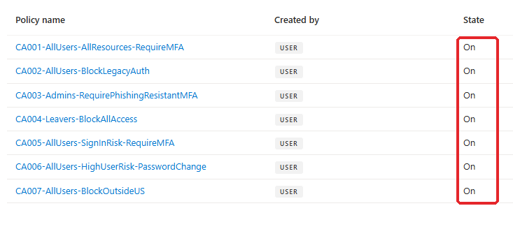

**Then I checked the enforced results**, on the sign-in log's Conditional Access tab this time instead of Report-only:

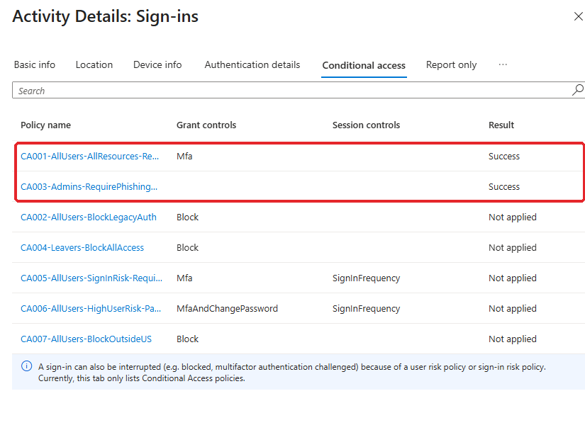

**My admin account:** CA001 and CA003 **Success**, everything else not applied. ✅

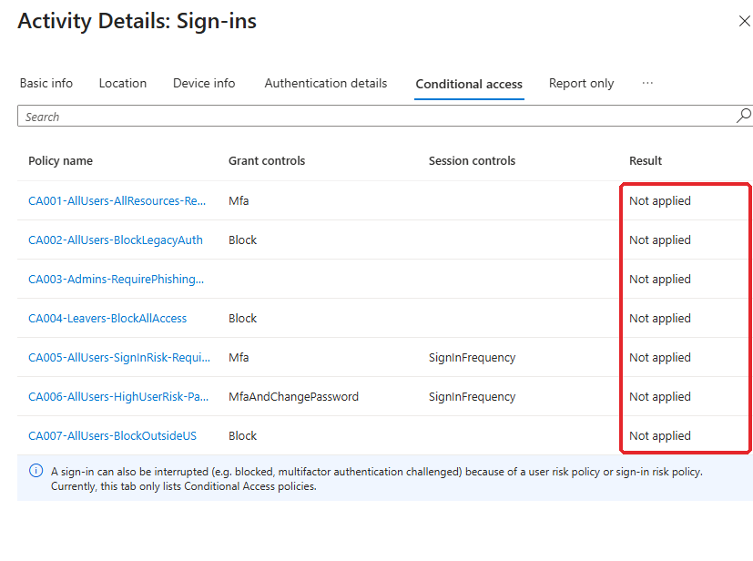

**Break-glass:** **every policy Not applied.** ✅ If a policy ever goes wrong, this account still gets in.

## 10. Alerts

The break-glass account should never be used, so if it is, someone needs to know right away. I built the alerts in Log Analytics from KQL queries.

**Alert 1: any break-glass sign-in**

```kql
SigninLogs
| where UserPrincipalName =~ "breakglass01@PotomacDefenseSystems.onmicrosoft.com"
| project TimeGenerated, UserPrincipalName, AppDisplayName, ResultType, ConditionalAccessStatus
```

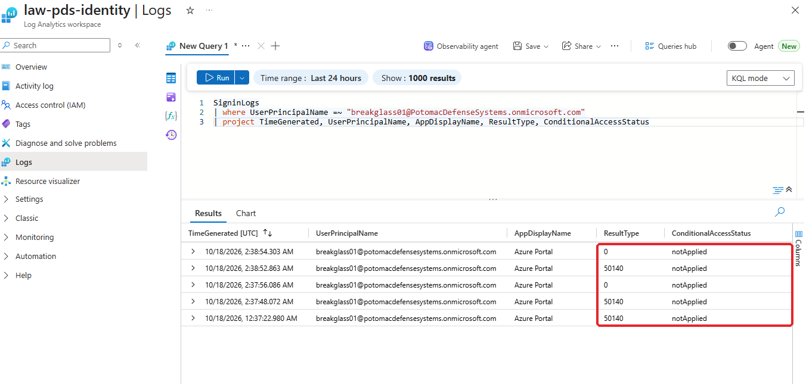

Two things in the results:
- Each sign-in shows up as a **pair**: `50140`, then `0`. `50140` isn't a failure. It's the "Stay signed in?" prompt, which Entra logs as an interruption
- **`ConditionalAccessStatus` is `notApplied` on every row.** That's the exclusion, now provable with a query instead of a screenshot

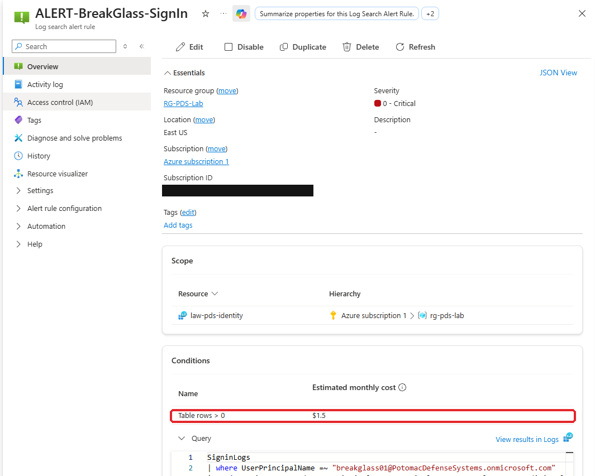

The rule runs every 5 minutes, fires if the query returns any rows, and emails the action group `ag-pds-identity-alerts`. Severity **0 (Critical)**, at about **$1.50 a month**.

**The test:** I signed in as break-glass again. The sign-in landed in the 2:52 to 2:57 UTC evaluation window, the alert fired at 2:58 UTC, and the email arrived at 10:58 PM my time.

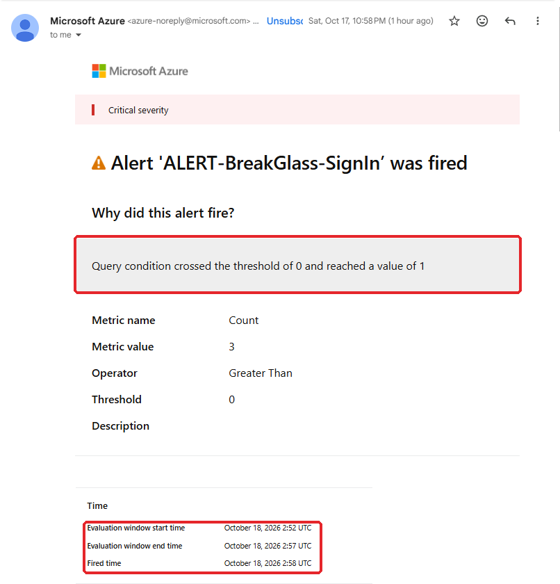

**Alert 2: any Conditional Access policy change**

```kql
AuditLogs
| where OperationName in ("Add conditional access policy", "Update conditional access policy", "Delete conditional access policy")
| project TimeGenerated, OperationName, ChangedBy = tostring(InitiatedBy.user.userPrincipalName), Policy = tostring(TargetResources[0].displayName)
```

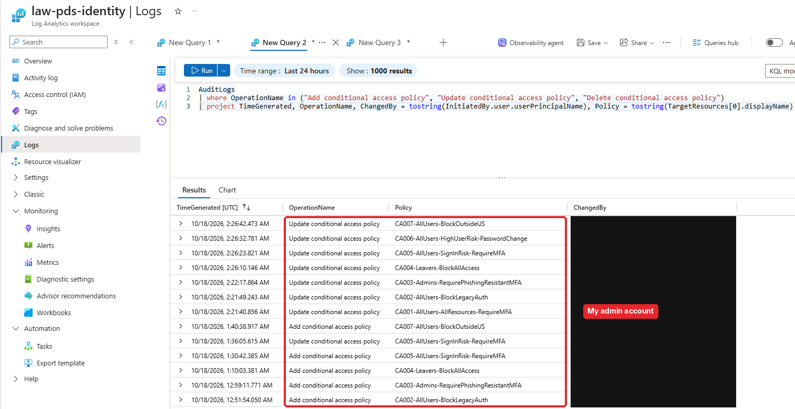

This returned the policy changes from that night, which doubles as an audit trail of the build: each policy added in report-only, CA005 updated when I added the missing sync exclusion, then all seven updated in a row as I turned them on.

One thing is missing: **CA001's creation**. I created it about 12 minutes after turning on the diagnostic setting, and the most likely explanation is that the logs weren't flowing to the workspace yet. The lesson is to turn on logging well before the changes you want on record.

**Alert 3: membership changes to the two CA groups**

```kql
AuditLogs
| where OperationName in ("Add member to group", "Remove member from group")
| where tostring(TargetResources) has_any ("CA-Exclude-EmergencyAccess", "CA-Block-Leavers")
| project TimeGenerated, OperationName, ChangedBy = tostring(InitiatedBy.user.userPrincipalName), Target = tostring(TargetResources[0].userPrincipalName)
```

These two groups are the quiet way to undo Conditional Access without touching a policy: add someone to the exclusion group and they skip every policy, or remove a leaver from the block group and their access comes back.

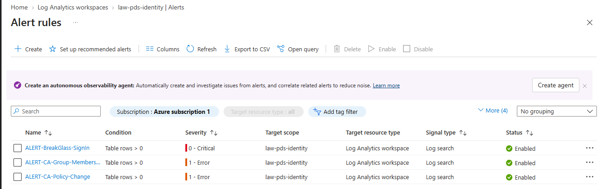

The fourth alert in the design, **Global Admin activated**, comes in Part 2.3, once PIM exists.

## 11. Findings

| # | Finding | Impact | Production fix |
|---|---|---|---|
| 1 | **No password writeback** | CA006 blocks high-risk synced users until an admin resets their password in AD. No self-service recovery | Enable password writeback in Entra Connect, then CA006 becomes a self-service secure password change |
| 2 | **One phishing-resistant method per admin** | My admin account's only way to satisfy CA003 is one phone. Lose it and recovery means a break-glass sign-in | Register two phishing-resistant methods per admin, such as a passkey plus a FIDO2 security key |
| 3 | **Mixed MFA controls** | CA001 and CA005 use "require MFA," CA006 uses an authentication strength. Same behavior today, harder to tighten later | Standardize on authentication strengths |
| 4 | **The details page hides location exclusions** | CA007's page showed "Any location" with no exclusion. Trusting it alone could hide a policy that blocks everyone | Verify location policies with What If (or the policy JSON), not the summary page |
| 5 | **A missing sync exclusion** | Caught on CA005 before enforcement. Once on, a risky-sign-in flag on the sync account would have broken sync | Use a checklist (or a policy template) for the standard exclusions |

## Test results

| Test | Expected | Result |
|---|---|---|
| What If: Chris Douglas | CA001 applies | ✅ |
| What If: break-glass | No policies apply | ✅ |
| What If: CA007 from a US IP | Not applied (Location) | ✅ |
| What If: CA007 from a German IP | Block | ✅ |
| Report-only on my admin sign-in | No failures before enforcing | ✅ (CA003 Success, thanks to the passkey) |
| Enforced: my admin sign-in | CA001 + CA003 Success | ✅ |
| Enforced: break-glass sign-in | Every policy Not applied | ✅ |
| Break-glass alert | Email within one evaluation cycle | ✅ |
| CA004 leaver block, end to end | Old password blocked faster than 79 s | ⏳ Scheduled with the VMs on |

## What I had at the end of 2.2

- [x] Seven Conditional Access policies, each tested in report-only before it was turned on
- [x] Security defaults replaced, with no gap in between
- [x] Phishing-resistant MFA enforced for admins
- [x] Break-glass proven to bypass every policy
- [x] Three alert rules, with the break-glass alert tested end to end
- [ ] CA004 tested against the Project 1 leaver

---

**Next:** 2.3 Privileged Identity Management (coming next) · [← Back to the project overview](../../README.md)
