# Part 2.3: Privileged Identity Management

[← 2.2 Conditional Access](../2.2-conditional-access/README.md) · **2.3** · [2.4 Access Packages →](../2.4-access-packages/README.md)

> **In this part:** I removed my own standing Global Administrator access. Admin roles are now **eligible**: I activate them when I need them, with MFA and a reason, and Global Admin also needs a second person to approve. Activations end on their own, every step lands in the audit log, and a Log Analytics alert fires whenever Global Admin is activated.
>
> **Design:** [`docs/01-design.md` section 5](../../docs/01-design.md#5-privileged-identity-management)

| # | Section | The lesson |
|---|---|---|
| 1 | [Role settings](#1-role-settings) | Stricter controls for the roles that can take over the tenant |
| 2 | [A second person who can approve](#2-a-second-person-who-can-approve) | An approver who can't sign in is no approver |
| 3 | [Removing my own standing GA](#3-removing-my-own-standing-ga) | Do it from a different account, and check both tabs |
| 4 | [Activating with approval](#4-activating-with-approval) | Request to admin access in about 2.5 minutes |
| 5 | [Proving it expired](#5-proving-it-expired) | The audit log, not the portal, is the evidence |
| 6 | [Alerts](#6-alerts) | A KQL alert and PIM's built-in alerts |
| 7 | [Living with it](#7-living-with-it) | Friction, and how I tuned it instead of turning it off |
| 8 | [Findings](#8-findings) | |

---

## 1. Role settings

Five roles from the design, each with controls that match what the role can do:

| Role | Max activation | Requires | Approval |
|---|---|---|---|
| **Global Administrator** | 1 hour | MFA + justification | **Monica Hayes (Security)** |
| **Privileged Role Administrator** | 1 hour | MFA + justification | **Monica Hayes** |
| User Administrator | 4 hours | MFA + justification | None |
| Helpdesk Administrator | 8 hours | MFA + justification | None |
| Security Reader | 8 hours | MFA + justification | None |

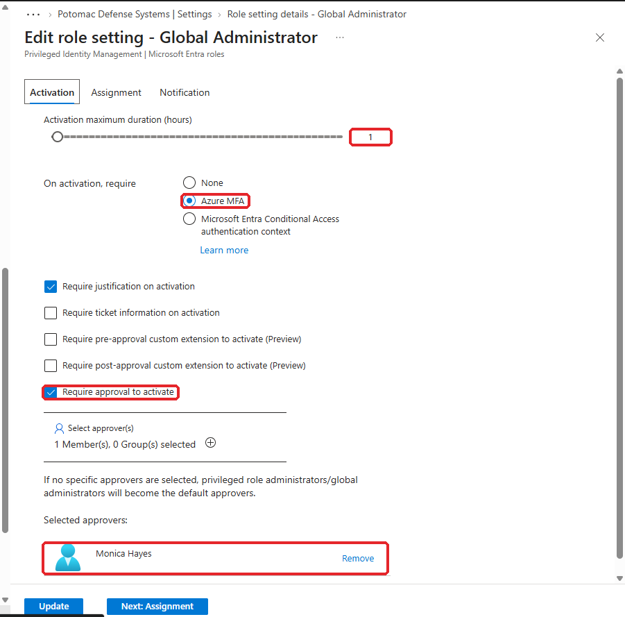

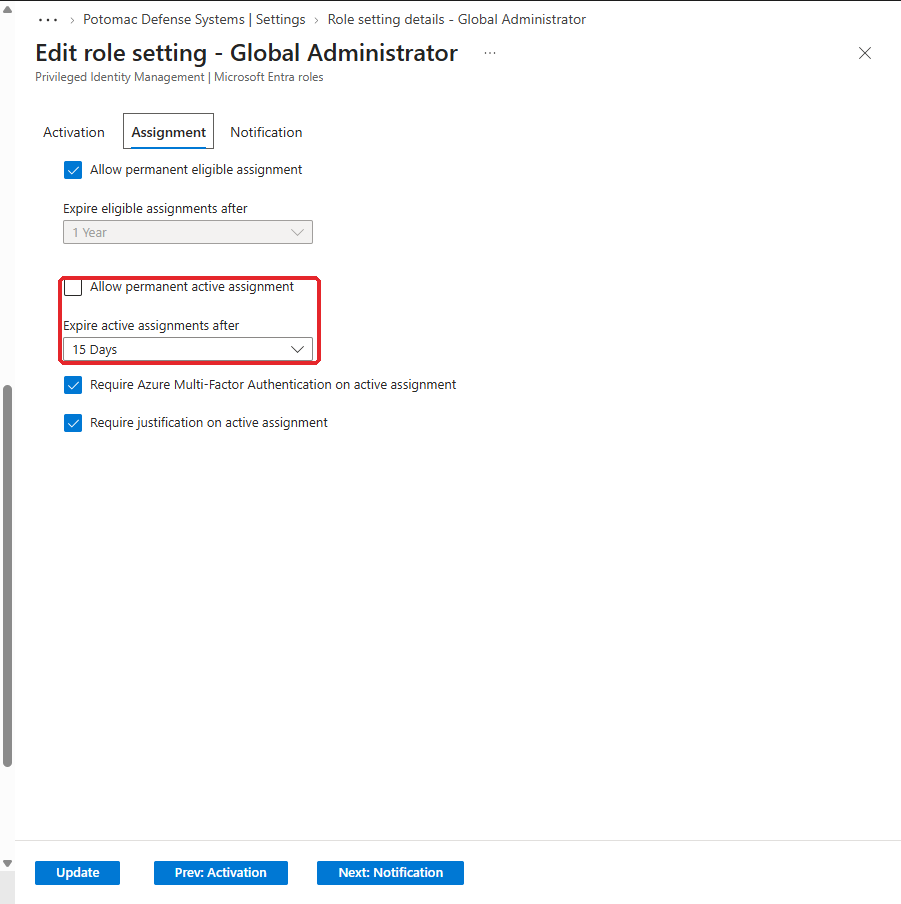

On the **Assignment** tab, I turned off permanent **active** assignments. Active assignments now expire after 15 days at most, so nobody can quietly get standing GA through PIM.

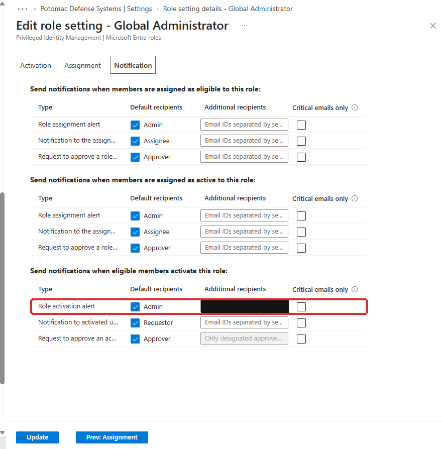

**Why Privileged Role Administrator gets the same rules as GA:** it can assign any role, including Global Admin, to anyone, including itself. If it were easier to activate than GA, it would be a way around the GA approval.

**Why only two roles need approval:** if every role needed a second person, approvers would start rubber-stamping, or people would push to get standing access back. Approval is kept for the roles that can take over the tenant. The rest still need MFA and a reason, expire on their own, and are logged.

**One change from the design:** the design had Security Reader at "MFA only." I added justification there too. It costs the user one sentence, and it makes the audit log answer "why was this person reading security settings?"

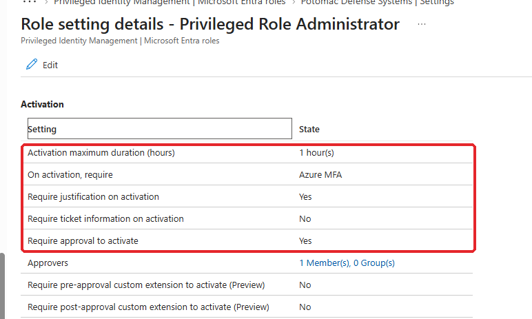

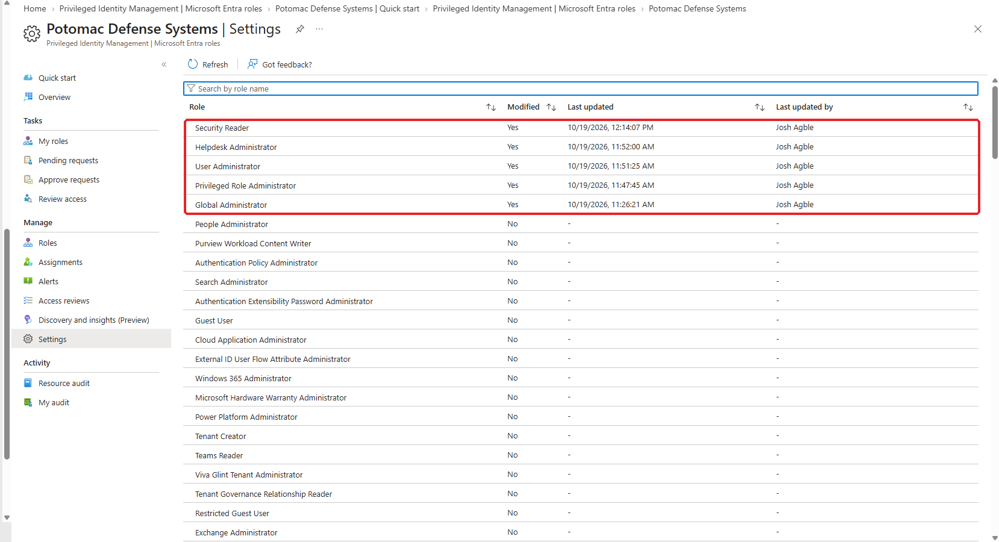

## 2. A second person who can approve

Approval only works if the approver can actually sign in. **Monica Hayes** is synced from AD, and this lab has no password writeback, so I couldn't reset her password from the cloud. I started the Project 1 VMs, reset her password in AD (along with Chris Douglas and Tom Haskins for later tests), and signed in as Monica once so she could register MFA.

**A finding on the way:** I'd lost the password for my Tier 0 AD account. The Azure portal's VM password reset doesn't support domain controllers, but **Run command** on the DC VM does, because it runs PowerShell as SYSTEM. Anyone with Contributor on that VM in Azure can reset any AD password, including Domain Admins. **Azure permissions on a domain controller VM are Tier 0.** That goes into the [part 2.8 review](../../docs/01-design.md#10-non-human-identity-review-part-28).

## 3. Removing my own standing GA

I made the change **as the break-glass account**, not as myself. That way removing my own admin rights couldn't lock me out halfway, and the change shows in the audit log as a deliberate emergency-account action. The break-glass sign-in alert from part 2.2 fired, as expected for a planned use.

1. Added my cloud admin account (`JoshAgble@…onmicrosoft.com`, cloud-only, not my synced everyday account) as **eligible** for Global Administrator
2. Removed my **active** Global Administrator assignment

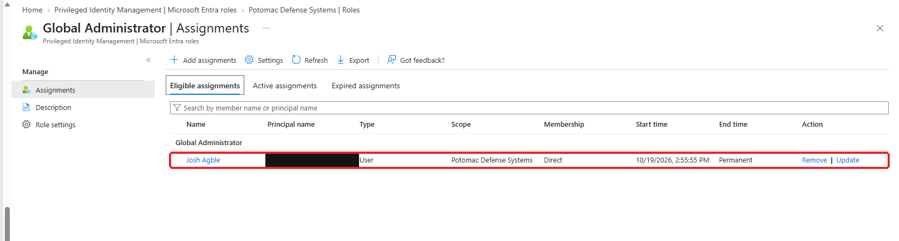

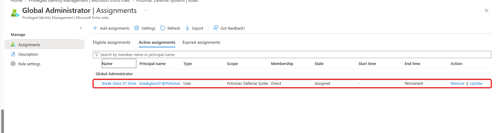

**What went wrong:** the first time, I removed the **eligible** assignment by mistake instead of the active one. Checking both tabs at the end caught it. I redid it in the safer order: remove active first, then add eligible, still as break-glass.

**Why the admin account must be cloud-only:** a synced account is controlled by on-prem AD. If AD were compromised, an attacker could reset that account's password and sign in to the cloud as a Global Admin. A cloud-only admin account means an on-prem breach doesn't become a cloud takeover.

## 4. Activating with approval

I requested Global Admin as myself in one browser and approved it as Monica in another.

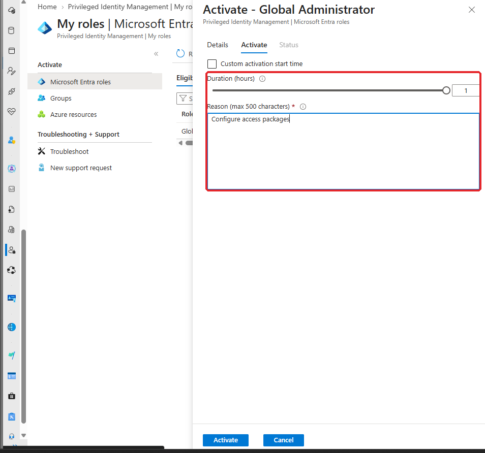

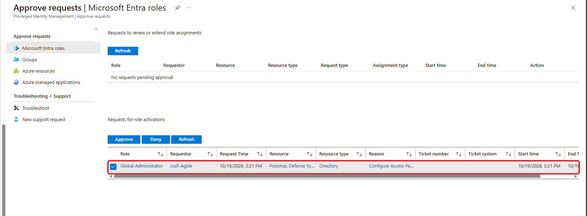

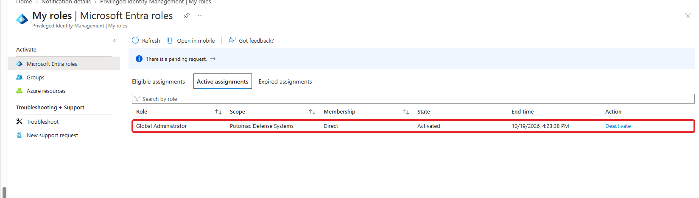

**Two things I noticed:**
- Monica got **no approval email**, because the test users don't have mailboxes. She saw the request under PIM → Approve requests
- While I had no admin role, CA003 (phishing-resistant MFA for admins) didn't apply to me. As soon as GA was active, my next sign-in needed the **passkey** again

## 5. Proving it expired

The portal's "Expired assignments" tab was empty, because it lists eligibility that ran out, not activations that ended. The audit log has the real story:

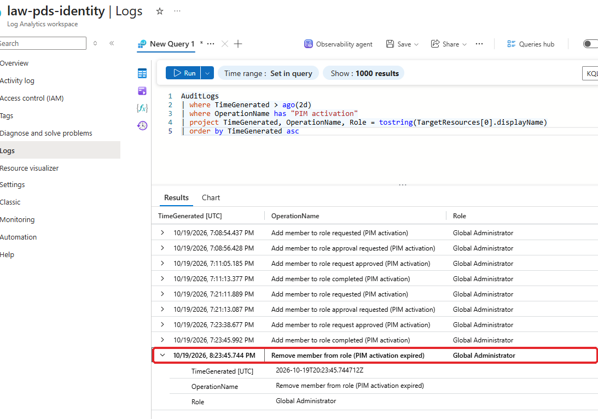

| Run | Requested | Monica approved | GA active | Ended |
|---|---|---|---|---|
| 1 (not captured) | 3:08:54 PM | 3:11:05 | 3:11:13 | I deactivated it early |
| 2 (screenshots) | 3:21:11 PM | 3:23:38 | 3:23:45 | **4:23:45, expired on its own** |

- **About 2.5 minutes from request to admin access.** Most of that was the approver switching browsers. After approval, the role was active within **7–8 seconds**
- **Exactly 60 minutes later**, the role removed itself. "Remove member from role (PIM activation expired)" was written by the system, not by a person

## 6. Alerts

**Global Admin activated:** a KQL alert in the same Log Analytics workspace as the part 2.2 alerts.

```kql
AuditLogs
| where OperationName == "Add member to role completed (PIM activation)"
| where tostring(TargetResources) has "Global Administrator"
| project TimeGenerated, OperationName, Who = tostring(InitiatedBy.user.userPrincipalName), Role = tostring(TargetResources[0].displayName), Reason = ResultReason
```

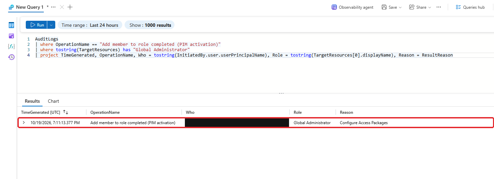

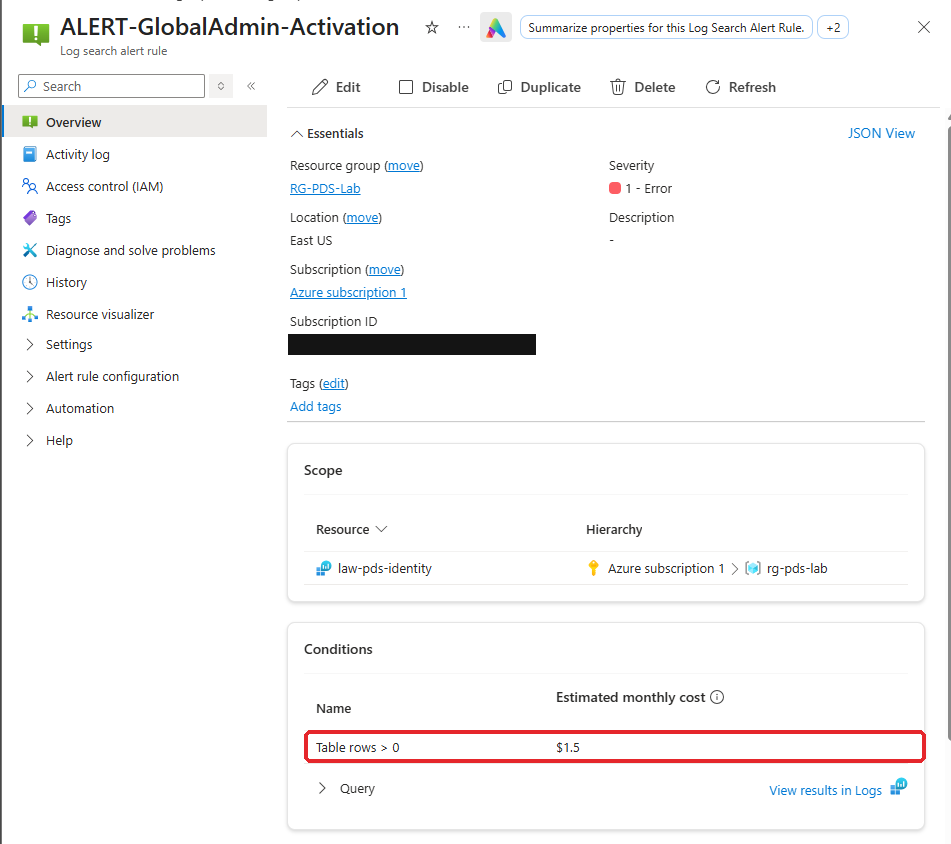

**PIM's built-in alerts:** all seven turned on (roles assigned outside PIM, too many Global Admins, roles without MFA on activation, stale accounts and others).

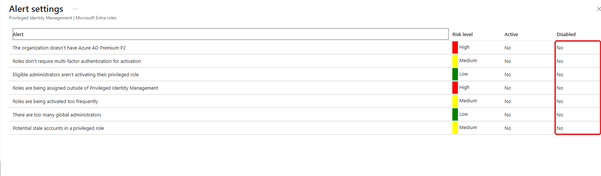

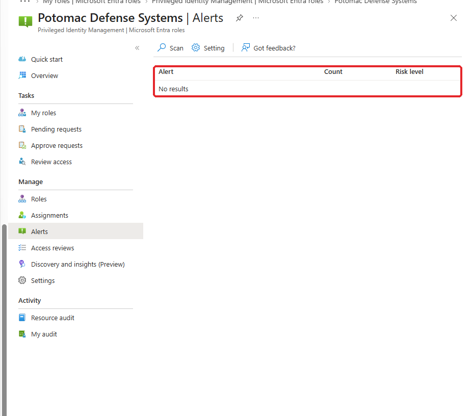

A scan found **nothing to fix**: two Global Admins (break-glass active, me eligible), MFA on every activation, and no roles assigned outside PIM. The "stale" and "unused role" alerts need weeks of history, so they'll come into play over time.

## 7. Living with it

Over the next session, the 1-hour GA activation ended partway through building access packages, more than once. At one point I wanted to make GA permanent again. Instead I changed how I use it:

- **Added an eligible User Administrator role for myself.** Licenses, users and passwords don't need GA. User Administrator activates in seconds, without approval, for 4 hours. GA is now only for things that need it (PIM, Conditional Access)
- **Learned the session gotcha:** after activating, the portal kept using my old sign-in until I opened a fresh window. A role that's "active" in PIM but not in your token looks like a permissions bug

"No standing admin" is supposed to cost something. The goal is to keep that cost small enough that nobody turns it off.

## 8. Findings

| # | Finding | Impact | Fix |
|---|---|---|---|
| 1 | **Run command on the DC VM resets any AD password** | Azure Contributor on the DC VM is effectively Domain Admin | Treat Azure RBAC on DC VMs as Tier 0. Restrict and alert on Run command (part 2.8) |
| 2 | **No password writeback** (again) | Every test user who had to sign in needed the VMs started and an AD reset | Enable password writeback, or self-service password reset with writeback |
| 3 | **Approvers without mailboxes** | Monica never got an email, only a portal queue | In production, approvers need mailboxes, or approvals go to Teams |
| 4 | **1-hour GA was too short for a build session** | Activations ended mid-task | Eligible User Administrator for routine work. GA could allow a longer window for planned changes |
| 5 | **"Expired assignments" doesn't show ended activations** | Easy to think an activation never expired | Use the audit log (`PIM activation expired`) as the evidence |

## What I had at the end of 2.3

- [x] No standing admin access except break-glass
- [x] Global Admin and Privileged Role Admin need MFA, a reason and Monica's approval, for 1 hour
- [x] A tested activation, approval and automatic expiry, all in the audit log
- [x] A Global Admin activation alert and PIM's built-in alerts
- [x] An eligible User Administrator role for routine work

---

**Next:** [2.4 Access Packages →](../2.4-access-packages/README.md)
