# Part 2.5: Access Reviews

[← 2.4 Access Packages](../2.4-access-packages/README.md) · **2.5** · 2.6 Incident Response (next)

> **In this part:** 2.4 controls who **gets** access. This part makes someone confirm, every quarter, that people should **keep** it. I built two reviews: Security reviews every admin role, and managers review their engineers' program data access. Then I tested both. A helpdesk tech lost an admin role he didn't need, and an engineer lost program access he no longer needed, both removed automatically once the reviewer said no.
>
> **Design:** [`docs/01-design.md` section 7](../../docs/01-design.md#7-access-reviews)

| # | Section | The lesson |
|---|---|---|
| 1 | [Why reviews](#1-why-reviews) | Access that was right when granted doesn't stay right |
| 2 | [Planting a mistake](#2-planting-a-mistake) | A review needs something to catch |
| 3 | [The privileged role review](#3-the-privileged-role-review) | "No change" when nobody answers, because of break-glass |
| 4 | [The program access review](#4-the-program-access-review) | It lives on the access package, not the group |
| 5 | [Test 1: Monica reviews admin roles](#5-test-1-monica-reviews-admin-roles) | The decision helper flagged Tyler before anyone else did |
| 6 | [Test 2: Priya reviews Chris](#6-test-2-priya-reviews-chris) | Denied, expired, and out of the group, with nobody touching it |
| 7 | [Findings](#7-findings) | |

---

## 1. Why reviews

| | Access packages (2.4) | Access reviews (2.5) |
|---|---|---|
| Question | Should this person **get** access? | Should this person **still have** access? |
| Who answers | Manager and program manager, at request time | Manager or Security, every quarter |
| Without it | People add themselves to groups by hand | Access piles up as people change jobs and finish tasks |

The 90-day expiry from 2.4 already ends requested access on its own. Reviews cover what expiry can't: admin roles, which are eligible with no end date, and access someone stopped needing before it expires.

## 2. Planting a mistake

A review that approves everything proves nothing. I made **Tyler Nguyen**, a helpdesk tech, eligible for two roles:

- **Helpdesk Administrator**, which matches his job
- **User Administrator**, the mistake: "temporary access for a license ticket" that nobody removed

User Administrator can reset passwords for most users, edit any user and assign licenses. That's far more than a helpdesk tech needs.

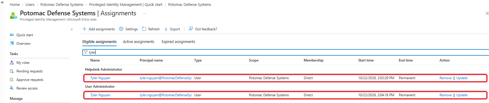

## 3. The privileged role review

Created in **PIM → Microsoft Entra roles → Access reviews**.

| Setting | Value | Why |
|---|---|---|
| Roles | Global Administrator, Privileged Role Administrator, User Administrator, Helpdesk Administrator | The roles that can take over the tenant or touch users |
| Assignment type | **All active and eligible** | An eligible role is still access. It just needs activating |
| Reviewer | **Monica Hayes** (Security) | Not the admins themselves. Nobody reviews their own access |
| Frequency | Quarterly, 14 days to respond | |
| Auto-apply results | **On** | A deny removes the role without anyone doing it by hand |
| If the reviewer doesn't respond | **No change** | See below |
| Recommendations, reason required, reminders | On | |

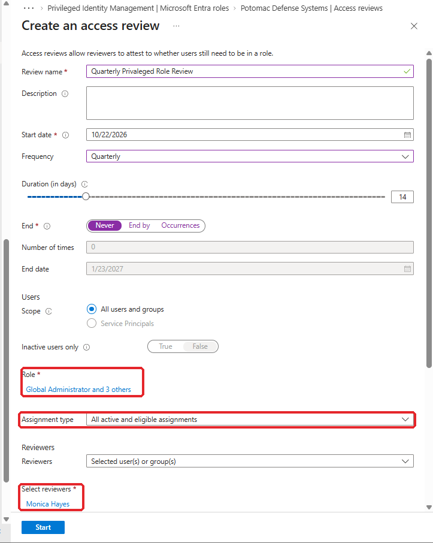

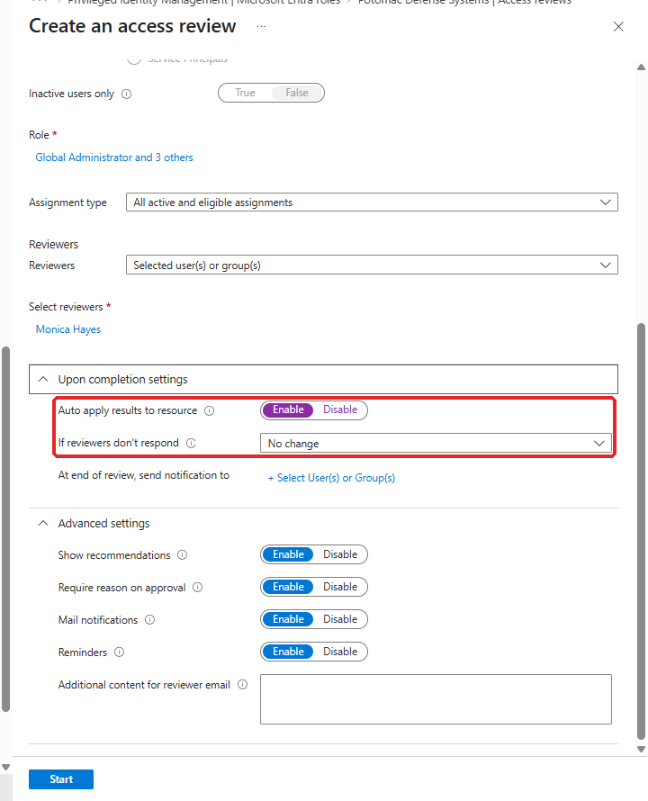

**One change from the design:** the design said "Remove access" if the reviewer doesn't respond. Break-glass holds a **permanent active** Global Administrator assignment, and it's in scope. If Monica missed the deadline, "Remove access" would delete the emergency account automatically. For admin roles, a missed review gets chased by a person, not acted on by the system.

## 4. The program access review

I expected to create this one under **Identity Governance → Access reviews**. The only choices for "What to review" were **Teams + Groups** and **Applications**. No access packages.

I could have reviewed the group `AP-Radar-Program-Data` instead, but a deny would then remove Chris from the group and leave his **access package assignment** marked as delivered. Entitlement management's records would no longer match reality. The review has to be on the **assignment**, so it lives in the package's policy: **Access package → Policies → Edit → Lifecycle → Access reviews**.

| Setting | Value | Why |
|---|---|---|
| Reviewer | The requester's **manager**, fallback **Monica Hayes** | The manager knows whether the task is finished |
| Frequency | Quarterly, 14 days | |
| If reviewers don't respond | **Remove access** | This is requested access. If nobody vouches for it, it goes, and the engineer can ask again |
| Decision helpers, justification, reminders | On | |

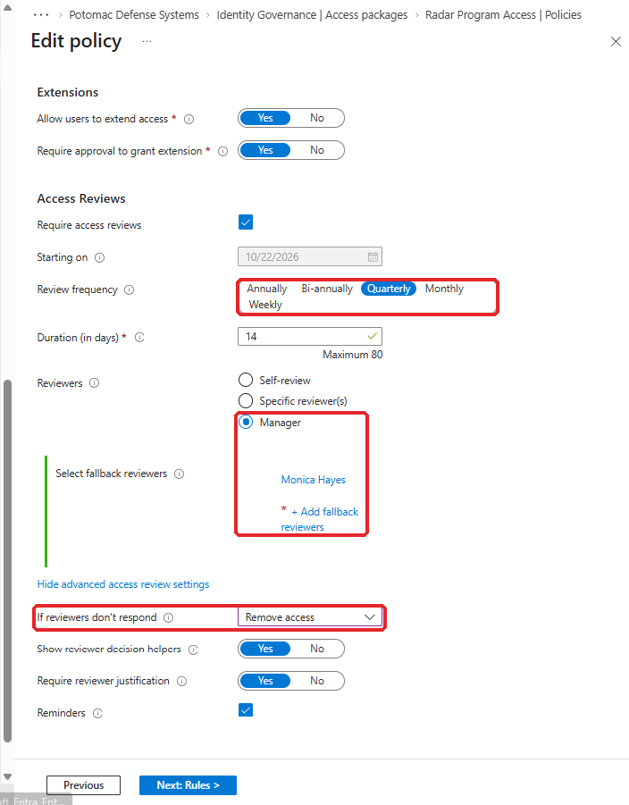

Satellite and Shipboard got the same settings.

**Why "Remove" here and "No change" for roles:** removing program access by default costs an engineer one new request. Removing an admin role by default could lock out the emergency account.

## 5. Test 1: Monica reviews admin roles

The role review started within minutes. Monica didn't see it in **My Access**. She found it under **PIM → Review access**, split into one review per role:

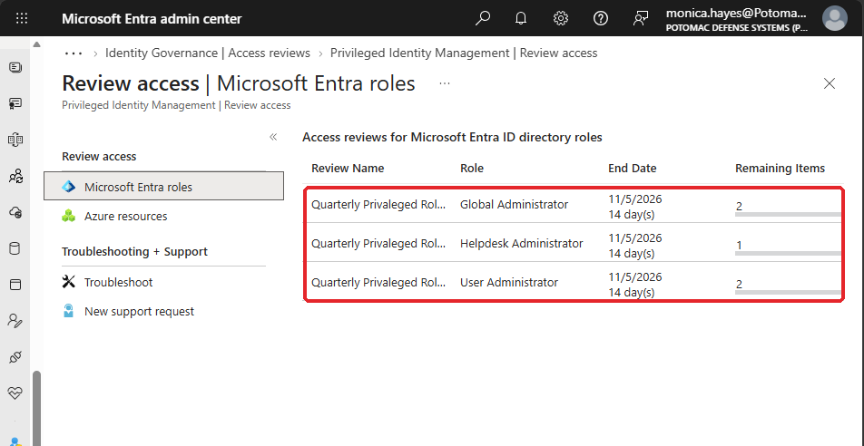

Privileged Role Administrator isn't listed because nobody holds it.

Before Monica decided anything, the **decision helper** recommended **Deny** for Tyler: he hadn't signed in for over 30 days. It recommended **Approve** for my account.

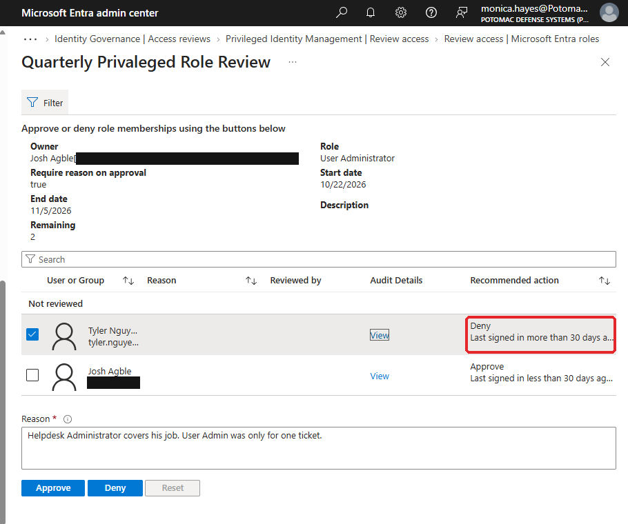

**What went wrong:** Monica clicked **Approve** on Tyler by mistake. Decisions can be changed until the review ends, so she reset it and denied with a reason. A real reviewer working through 200 rows will make the same slip, so the review window is a safety net, not just a deadline.

Her decisions:

| Role | Person | Decision |
|---|---|---|
| User Administrator | **Tyler Nguyen** | **Deny**: "Helpdesk Administrator covers his job. User Admin was only for one ticket." |
| User Administrator | Josh Agble | Approve |
| Helpdesk Administrator | Tyler Nguyen | Approve |
| Global Administrator | breakglass01 | Approve: emergency access account, monitored by a Sev0 alert |
| Global Administrator | Josh Agble | Approve |

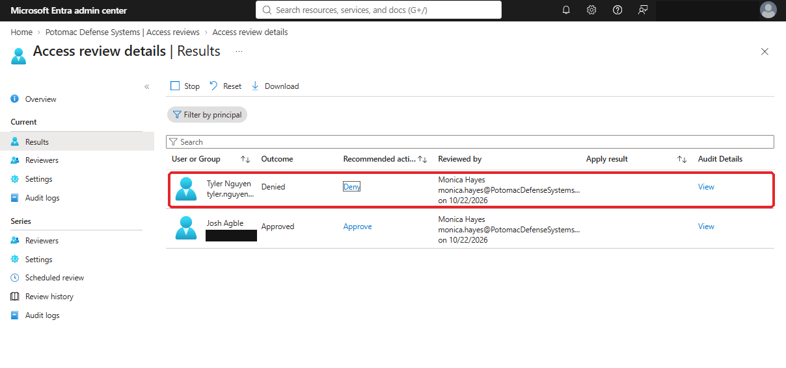

The audit log records who decided, when, and the **written reason**:

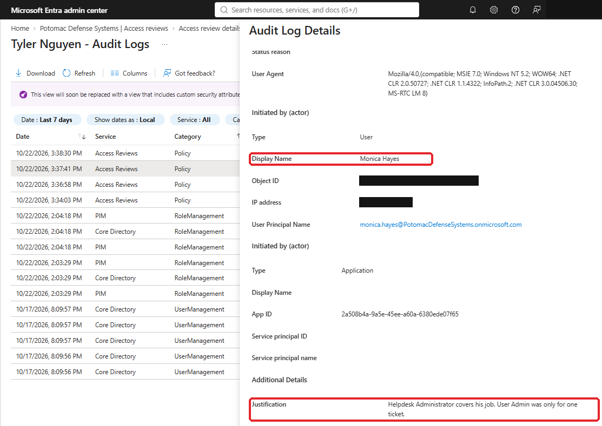

**Nothing changed until the review ended.** Tyler kept User Administrator after Monica's deny. Results only apply when the review stops, either at the 14-day deadline or when an admin stops it early. I stopped it, and within minutes:

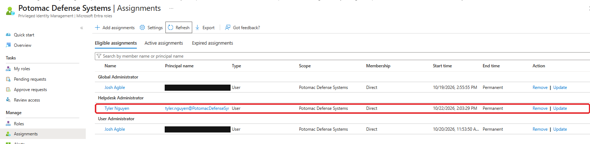

Compare it with the first screenshot. The extra role is gone, and nobody removed it by hand.

## 6. Test 2: Priya reviews Chris

Chris Douglas got Radar program access in 2.4, approved by Priya (his manager) and Tom (Radar program manager). The task is over, so Priya should take it back.

**The review didn't start the same day.** The role review started within minutes. The review created by the package policy sat at **Not started** for the rest of the afternoon and was active by the next morning.

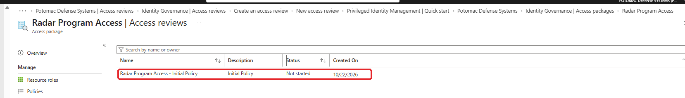

Unlike the role review, Priya found this one in **My Access**:

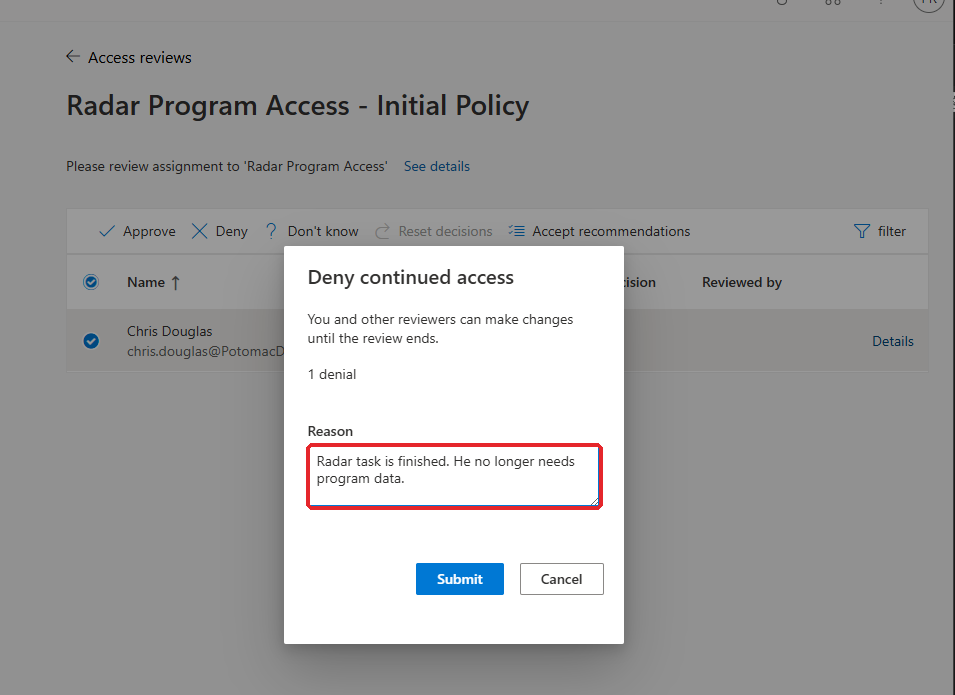

I stopped the review, and the deny applied:

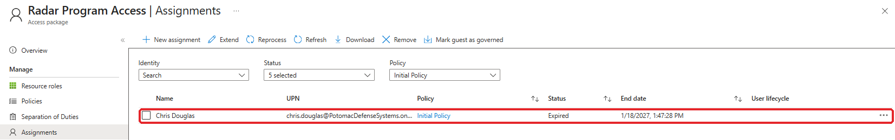

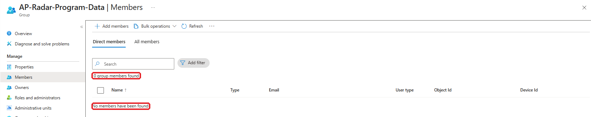

Chris's assignment shows **Expired**, with an original end date of 1/18/2027. The review ended it 87 days early. Entitlement management then removed him from the group, so the assignment and the group stayed in sync. That's the whole reason for reviewing the package and not the group.

## 7. Findings

| # | Finding | Impact | Fix |
|---|---|---|---|
| 1 | **Access package reviews aren't in "What to review"** | The obvious path offers only Teams + Groups and Applications. Reviewing the group would leave entitlement management's records wrong | Configure package reviews in the package policy's Lifecycle tab |
| 2 | **The policy-created review took overnight to start** | Couldn't test the same day. The role review started in minutes | Set review start dates a day ahead of when reviewers are told to expect them |
| 3 | **Role reviews didn't appear in My Access** | Monica saw nothing until she went to PIM → Review access. Package reviews did appear in My Access | Reviewer instructions should name both places, or send the direct link |
| 4 | **Nothing is removed until the review ends** | A deny on day 1 of a 14-day review isn't applied until day 14 | Reviews are for recertification, not urgent removal. For a leaver or an incident, remove access directly |
| 5 | **A misclick approved the over-privileged account** | Easy to approve the one row that matters | Decisions can be reset until the end. Reviewers should check the recommendation column before approving |

My Global Admin activation also ended mid-test ("401 No access"), the same 1-hour limit from [2.3 finding 4](../2.3-privileged-identity-management/README.md#8-findings).

## Test results

| Test | Expected | Result |
|---|---|---|
| Decision helper flags over-privilege | Recommends Deny for Tyler's User Administrator | ✅ Deny, based on 30+ days without sign-in |
| Security reviews admin roles | Monica denies Tyler's User Administrator, with a reason | ✅ Reason recorded in the audit log |
| Deny applies automatically | Tyler keeps only Helpdesk Administrator | ✅ |
| Break-glass survives the review | Approved, and "No change" if no response | ✅ |
| Manager reviews program access | Priya denies Chris's Radar access | ✅ |
| Program access removed | Assignment expired and group membership removed, with nobody touching either | ✅ |

## What I had at the end of 2.5

- [x] A quarterly privileged role review by Security, covering active and eligible assignments, with auto-apply
- [x] Quarterly manager reviews on all three program packages, removing access if nobody responds
- [x] An over-privileged admin role found by the decision helper, denied, and removed automatically
- [x] A finished task's program access denied by the manager, with the assignment and group membership removed automatically

---

**Next:** 2.6 Incident Response (coming next) · [← Back to the project overview](../../README.md)
