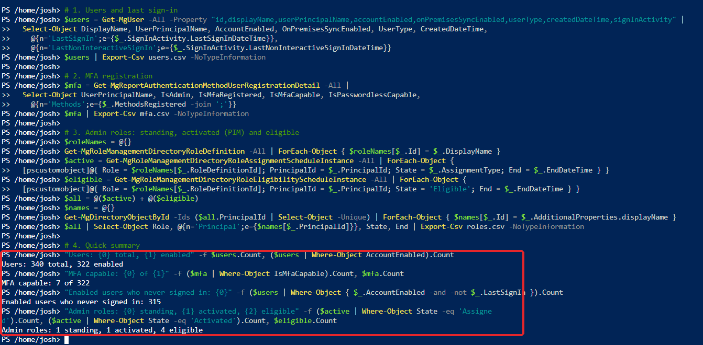
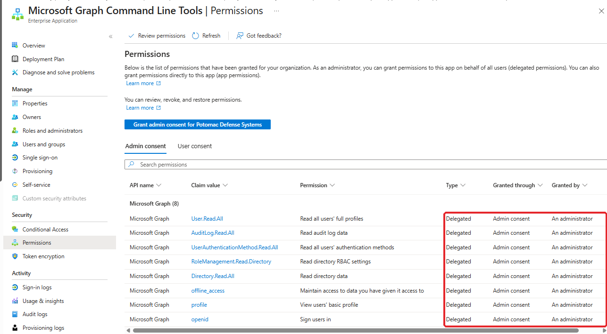
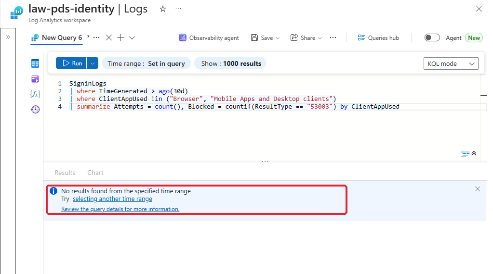

# Part 2.7: Identity Metrics

[← 2.6 Incident Response](../2.6-incident-response/README.md) · **2.7** · [2.8 Non-Human Identities →](../2.8-non-human-identities/README.md)

> **In this part:** I measured how healthy the tenant's identities are, in the format a security manager would read in two minutes: MFA coverage, standing admins, access review completion, stale accounts and legacy authentication. The numbers mostly met their targets. The ones that didn't pointed at real gaps.
>
> **The report:** [`docs/04-identity-metrics-report.md`](../../docs/04-identity-metrics-report.md) · **Design:** [`docs/01-design.md` section 9](../../docs/01-design.md#9-identity-metrics-part-27)

| # | Section | The lesson |
|---|---|---|
| 1 | [Getting the data](#1-getting-the-data) | One read-only export, and the export tool is itself an app with permissions |
| 2 | [Results](#2-results) | 100% of active users, 2% of all accounts |
| 3 | [Findings](#3-findings) | |

---

## 1. Getting the data

Most of the data isn't in Log Analytics: MFA registration, role assignments, and last sign-in for accounts that never signed in. I exported it from Microsoft Graph with a read-only script, [`scripts/2.7-export-identity-data.ps1`](../../scripts/2.7-export-identity-data.ps1), run in Azure Cloud Shell. It writes three CSVs: users with last sign-in, MFA registration details, and admin role assignments (standing, activated and eligible).



**The tool is a non-human identity too.** Running Graph PowerShell the first time created **Microsoft Graph Command Line Tools** in the tenant, with 8 delegated permissions granted by **admin consent for the whole organization**:



Delegated permissions are still limited by each user's own role, so a regular user can't read audit logs through it. But the consent applies tenant-wide. It goes into the 2.8 inventory.

**Legacy authentication** comes from the sign-in logs:

```kql
SigninLogs
| where TimeGenerated > ago(30d)
| where ClientAppUsed !in ("Browser", "Mobile Apps and Desktop clients")
| summarize Attempts = count(), Blocked = countif(ResultType == "53003") by ClientAppUsed
```



Zero attempts since logging began. CA002 blocks legacy authentication, but nothing in this tenant has tried it, so the policy hasn't been tested against real traffic.

## 2. Results

| Metric | Result | Target | |
|---|---|---|:---:|
| MFA registration, users who sign in | **7 of 7** (100%) | 100% of active users | ✅ |
| MFA registration, all enabled accounts | 7 of 322 (2%) | n/a | ⚠️ |
| Standing privileged role assignments | **1** (break-glass) | 1 | ✅ |
| Access review completion | **6 of 6** decisions, 2 removals | 100% | ✅ |
| Stale accounts (90 days) | 0. The tenant is 26 days old | Identified | ℹ️ |
| Enabled accounts that never signed in | 315 | Reviewed | ⚠️ |
| Legacy authentication attempts | **0** | Tracked | ✅ |

**Both MFA numbers are true, and they answer different questions.** Everyone who uses the tenant has MFA. But 315 accounts created by the Project 1 JML engine have never been used, so none of them has MFA registered yet. Reporting only the 100% would hide that.

The full breakdown, including privileged access and access reviews, is in the [report](../../docs/04-identity-metrics-report.md).

## 3. Findings

| # | Finding | Impact | Fix |
|---|---|---|---|
| 1 | **315 enabled accounts with no MFA registered** | CA001 requires MFA at sign-in, so the first person to sign in with the password registers it. That could be an attacker | Temporary Access Pass for onboarding, Conditional Access on security info registration, accounts disabled until the start date |
| 2 | **Break-glass uses phishable MFA** | Push and one-time code on the most powerful account. Break-glass is excluded from CA003 by design, so nothing enforces stronger MFA | FIDO2 security keys for break-glass, stored securely |
| 3 | **Stale accounts can't be measured yet** | No account is 90 days old | Re-run monthly. Track "never signed in" until then |
| 4 | **18 disabled leaver accounts with no deletion date** | A disabled account can be re-enabled by mistake | A retention window for leavers, then delete |
| 5 | **Getting the metrics took a manual, interactive export** | Metrics only exist when someone remembers to run them | Automate it with a managed identity runbook (2.8) |
| 6 | **Graph Command Line Tools has tenant-wide admin consent** | Any user can use the app with the consented permissions, within their own role | Review in 2.8. Consent per user, or require assignment |

## What I had at the end of 2.7

- [x] A read-only export of users, MFA registration and admin roles
- [x] A one-page [identity metrics report](../../docs/04-identity-metrics-report.md) with targets and status
- [x] Six findings, two of them carried into 2.8

---

**Next:** [2.8 Non-Human Identities →](../2.8-non-human-identities/README.md) · [← Back to the project overview](../../README.md)
