# Part 2.8: Non-Human Identities

[← 2.7 Identity Metrics](../2.7-identity-metrics/README.md) · **2.8** · [Project overview](../../README.md)

> **In this part:** people aren't the only identities in the tenant. Apps, scripts and services sign in too, and they're often the least governed. I inventoried every one, planted the "forgotten reporting app" every tenant has, applied my design's findings rules, fixed what they found, and moved the 2.7 metrics onto a **managed identity**: a runbook with no password, secret or certificate anywhere.
>
> **Inventory and findings:** [`docs/05-nhi-inventory.md`](../../docs/05-nhi-inventory.md) · **Design:** [`docs/01-design.md` section 10](../../docs/01-design.md#10-non-human-identity-review-part-28)

| # | Section | The lesson |
|---|---|---|
| 1 | [Planting a risky app](#1-planting-a-risky-app) | A review needs something to catch |
| 2 | [The inventory](#2-the-inventory) | An app I didn't create turned out to be Tier 0 |
| 3 | [Fixing what it found](#3-fixing-what-it-found) | Owners, consent, an alert, and a deletion |
| 4 | [The managed identity](#4-the-managed-identity) | The metrics report, with nothing to steal |
| 5 | [Findings](#5-findings) | |

---

## 1. Planting a risky app

The story: a contractor built a reporting tool two years ago, gave it a secret and broad read access, and left. I created `PDS-Legacy-Reporting` with:

- A **client secret valid for 2 years**. I never copied the value
- **`Directory.Read.All`** as an application permission, with admin consent
- **No owner**

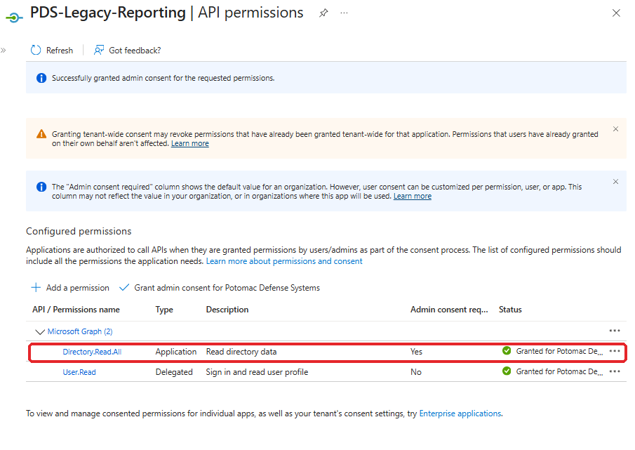

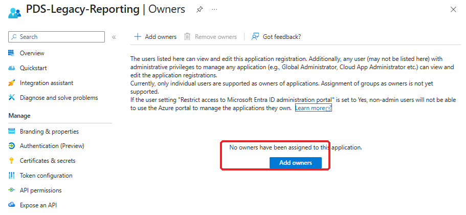

## 2. The inventory

A read-only script, [`scripts/2.8-nhi-inventory.ps1`](../../scripts/2.8-nhi-inventory.ps1), lists every app registration with its owners, secrets and certificates, application permissions and last sign-in, plus every delegated consent and managed identity.

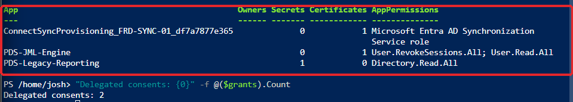

| App | Findings |
|---|---|
| `ConnectSyncProvisioning_FRD-SYNC-01` | **Created by Entra Connect**, not by me. It holds the directory synchronization role, so it's **Tier 0**: whoever can add a credential to it can write to the directory as the sync service. No owner. Its 90-day certificate is rotated by Connect, which is good |
| `PDS-JML-Engine` | My Project 1 automation. **No owner.** Certificate and 2 permissions are fine |
| `PDS-Legacy-Reporting` | 4 of 5 rules: no owner, a secret, valid over a year, never used. Plus directory-wide read |
| Graph Command Line Tools | The tool from 2.7, with delegated permissions consented **for all users** |

**Two surprises in the consents:**
- Granting admin consent to the planted app also consented its default delegated `User.Read` **for every user**
- The Graph Command Line Tools permissions from 2.7 were **gone**, replaced by today's. Each org-wide consent replaced the previous one. The portal even warns about it: *"Granting tenant-wide consent may revoke permissions that have already been granted tenant-wide"*

## 3. Fixing what it found

**An owner for the JML engine:**

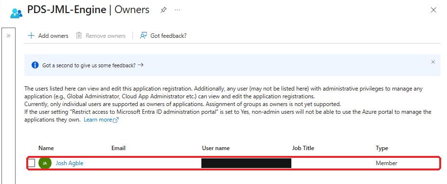

**No owner for the Connect sync app, on purpose.** Owners can add credentials, so adding one would widen the path to Tier 0. The accountable owner is recorded in the inventory instead, and credential changes are alerted.

**An alert on any new app credential.** Tested first against the secret I'd just created:

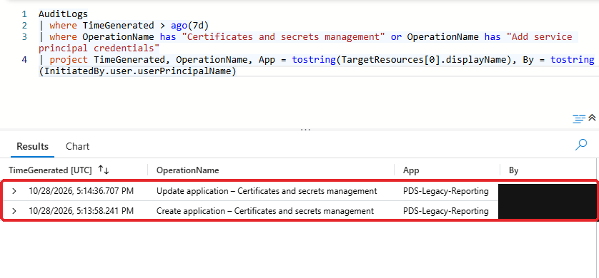

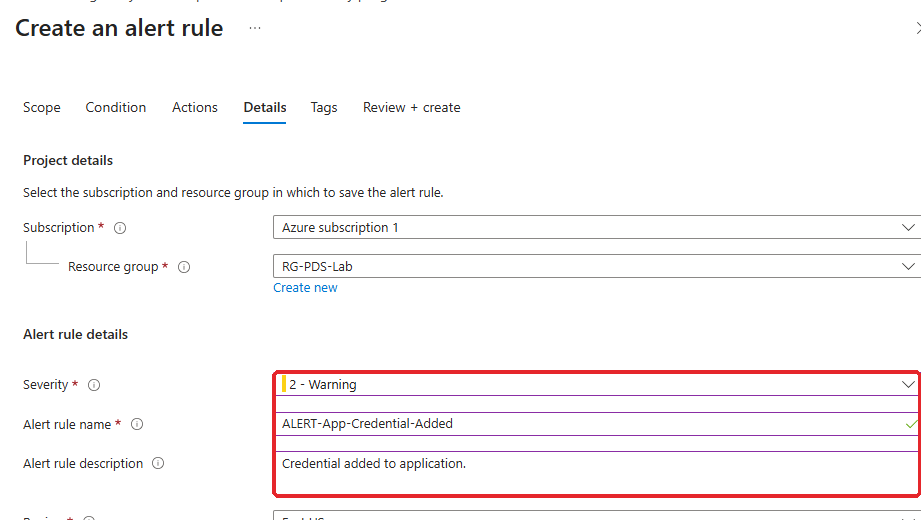

**Graph Command Line Tools restricted to my admin account:**

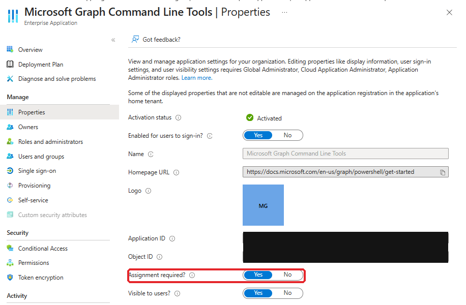

**The planted app deleted:**

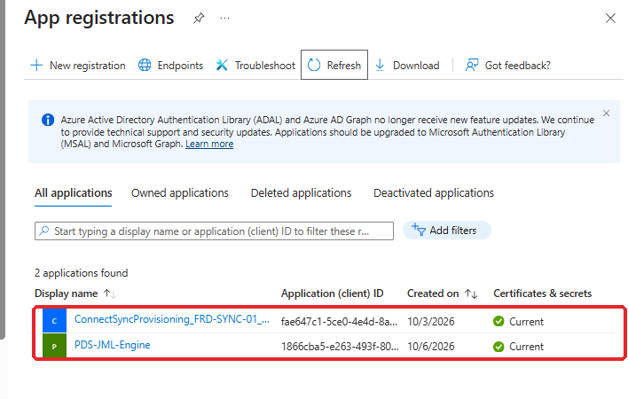

## 4. The managed identity

2.7's metrics needed me to sign in and run an export by hand. Now they run on their own as an **Azure Automation account with a system-assigned managed identity**. Azure issues the identity's tokens itself, so there's nothing to store, rotate or leak.

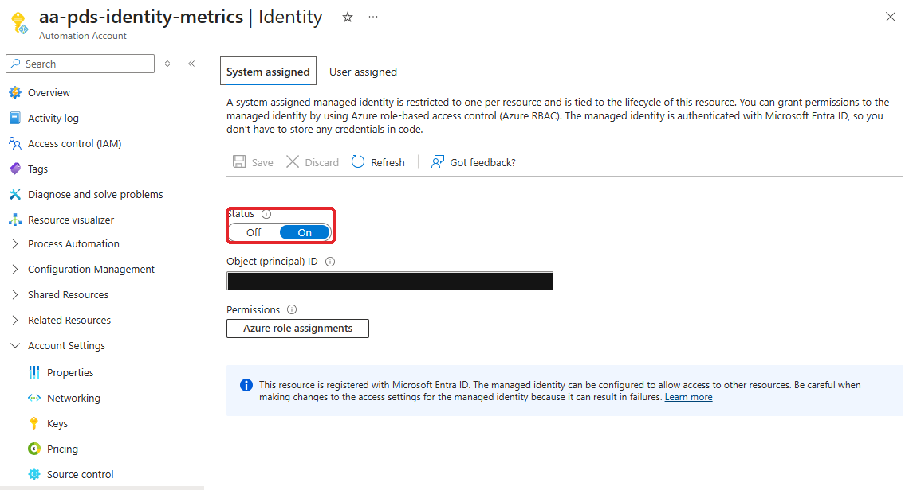

The portal can't grant Graph permissions to a managed identity, so I used [`scripts/2.8-grant-managed-identity-permissions.ps1`](../../scripts/2.8-grant-managed-identity-permissions.ps1). At the consent prompt I **consented for myself only**, so this setup didn't replace the org-wide consent again.

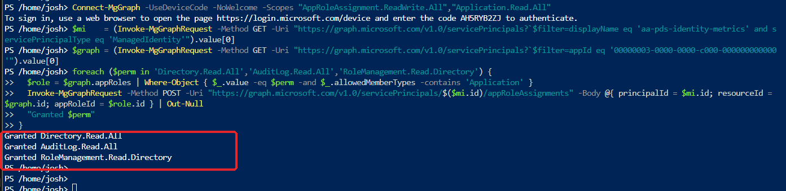

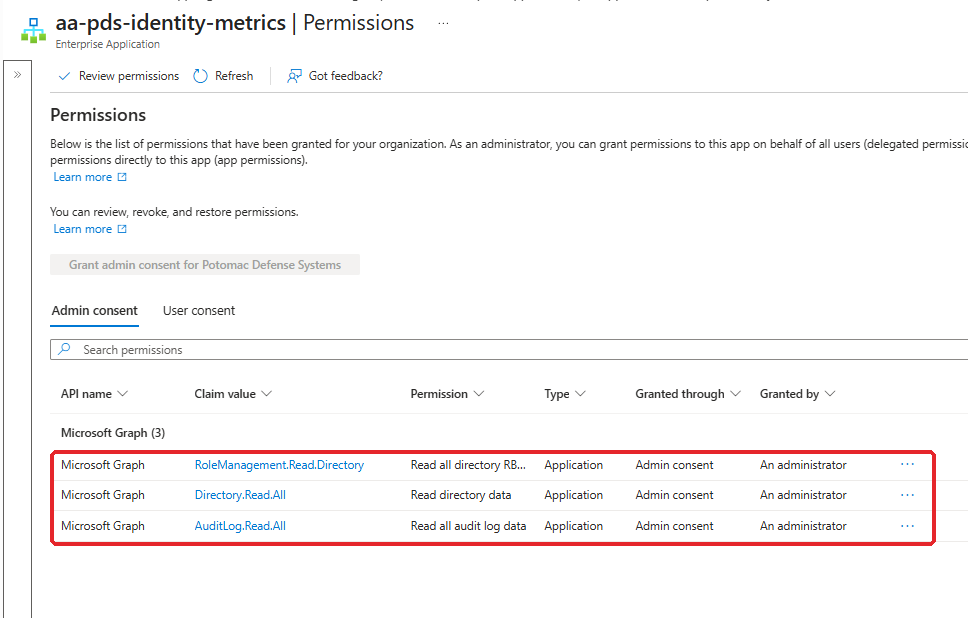

**Three read-only permissions:** directory, audit log (sign-ins and MFA registration) and role management. Compare that with the planted app's secret and missing owner.

The runbook, [`scripts/2.8-Get-IdentityMetrics.runbook.ps1`](../../scripts/2.8-Get-IdentityMetrics.runbook.ps1), gets a token from the Automation sandbox, calls Graph and prints the metrics:

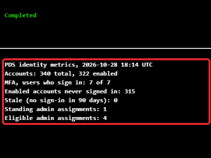

**The same numbers as the manual 2.7 export:** 340 accounts, 7 of 7 MFA, 315 never signed in, 1 standing admin, 4 eligible. It runs every Monday:

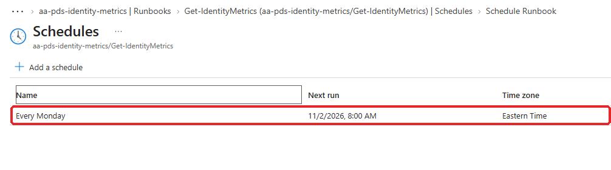

## 5. Findings

| # | Finding | Impact | Fix |
|---|---|---|---|
| 1 | **The Entra Connect sync app is Tier 0, unowned and unmonitored** | A new credential on it would let someone act as the sync service | Credential alert (done). Treat it like a domain controller |
| 2 | **The JML engine had no owner** | Nobody accountable for the app that offboards people | Owner added (done) |
| 3 | **Unowned app with a 2-year secret and directory-wide read, never used** | A leaked secret maps the whole organization | Deleted (done) |
| 4 | **Admin consent also granted default delegated permissions to every user** | Hidden tenant-wide grants | Remove unused delegated permissions before consenting |
| 5 | **An org-wide consent replaced the previous one** | Permissions silently disappeared | Consent for yourself for admin tooling (done) |
| 6 | **The admin tool was usable by every user** | Org-wide consent on Graph Command Line Tools | Assignment required (done) |
| 7 | **Admin tooling uses device code sign-in** | A known phishing technique | Conditional Access: block device code flow except for admins (open) |
| 8 | **Entra access reviews can't review app permissions** | The design's app permission review has no built-in equivalent | Quarterly inventory with owner attestation (open) |

## Test results

| Test (from the design) | Result |
|---|---|
| The inventory lists every app registration in the lab | ✅ 3 apps, including one I didn't create |
| The planted risky app is flagged | ✅ 4 of 5 rules, then deleted |
| The metrics run as a managed identity with no stored credential | ✅ Output matches the 2.7 export |
| An app permission access review | ❌ Not available as a built-in review. Replaced with owner attestation |

## What I had at the end of 2.8

- [x] An inventory of every non-human identity, with findings rules applied
- [x] Every app owned or deliberately accounted for, and the risky one deleted
- [x] An alert on any new app credential
- [x] Identity metrics running weekly as a managed identity, with no credential to manage

---

**Project 2 complete.** [← Back to the project overview](../../README.md)
